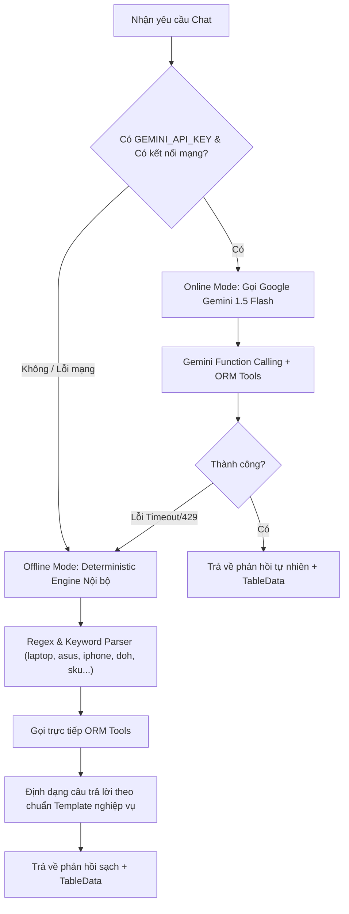

# ĐẶC TẢ KIẾN TRÚC KỸ THUẬT PHÂN HỆ TRỢ LÝ AI CHATBOT
## (TOOL-AUGMENTED RAG VỚI FUNCTION CALLING & DUAL-MODE RESILIENCE)

- **Dự án**: Dynamic Pricing System (LQSMART-OJT)
- **Đơn vị**: FPT Shop / FPT Software
- **Phân hệ**: EPIC 5 — Trợ lý AI Chat (AI Pricing Assistant & Explainable Engine)
- **Hạng mục PBI**: PBI-017 (Chatbot hỏi đáp nghiệp vụ RAG) & PBI-018 (Giải thích minh bạch lý do đề xuất giá)
- **Tài liệu tham chiếu**: [[Dynamic Pricing Index]], [[Product Backlog – Dynamic Pricing]], [[PHAN_TICH_KIEN_TRUC_CHATBOT_AI]]

---

## 1. TỔNG QUAN HỆ THỐNG

### 1.1. Mục đích tài liệu
Tài liệu này đặc tả chi tiết kiến trúc kỹ thuật, luồng dữ liệu, hợp đồng giao tiếp (Contracts), cơ chế Function Calling, cấu trúc dịch vụ và giao thức an toàn cho phân hệ Trợ lý AI Chatbot (**FPT Shop Market Copilot**).

### 1.2. Mục tiêu kỹ thuật
- Cho phép người dùng duy nhất (**Pricing Analyst**) tra cứu thông tin giá đối thủ, rủi ro hàng tồn kho và nhận báo cáo định lượng bằng ngôn ngữ tự nhiên.
- Cung cấp cơ chế giải trình minh bạch 3 lớp (**3-Tier Explainable AI**) khi người dùng yêu cầu phân tích lý do đề xuất điều chỉnh giá của thuật toán.
- Đảm bảo 100% tính chính xác của các quy tắc nghiệp vụ định giá thông qua việc đóng gói logic vào các hàm **SQLAlchemy ORM** an toàn.
- Cung cấp cơ chế chạy kép (**Dual-Mode**): Kết hợp mô hình ngôn ngữ lớn **Google Gemini 1.5 Flash** cho môi trường trực tuyến và **Deterministic Engine** nội bộ cho môi trường ngoại tuyến / kiểm thử tự động.

---

## 2. KIẾN TRÚC TỔNG THỂ (SYSTEM TOPOLOGY)

Hệ thống được thiết kế theo mô hình **Clean Layered Architecture**, chia tách độc lập giữa tầng giao diện, tầng định tuyến API, tầng suy luận AI, tầng công cụ nghiệp vụ và tầng lưu trữ.

```mermaid
graph TD
    subgraph UI ["Presentation Layer (Frontend React + Vite)"]
        UI_FAB["Floating Action Button"]
        UI_Popup["Compact Popup (380px)"]
        UI_Drawer["Expanded Studio Drawer (750px)"]
        UI_Card["ExplainableCard (3 Tiers)"]
    end

    subgraph API ["API & Routing Layer (FastAPI Backend)"]
        EP_Chat["POST /api/v1/ai/chat"]
        EP_Explain["GET /api/v1/ai/explain/{sku}"]
        EP_Sessions["GET /api/v1/ai/sessions"]
    end

    subgraph Orchestration ["Reasoning & Orchestration Layer"]
        Service_Chat["AiChatService"]
        Gemini_Client["GeminiClient (Function Calling)"]
        Fallback_Engine["Deterministic Engine (Offline Fallback)"]
    end

    subgraph Tools ["Semantic Tool Layer (SQLAlchemy ORM)"]
        Tool_Price["get_price_discrepancies()"]
        Tool_Inv["get_inventory_risks()"]
        Tool_Explain["get_sku_explain_factors()"]
    end

    subgraph Storage ["Persistence Layer (PostgreSQL / SQLite)"]
        DB_Crawl["crawl_results (Competitors)"]
        DB_Match["sku_mappings (Approved Links)"]
        DB_Inv["inventories (Stock & DOH)"]
        DB_Rec["price_recommendations (Floor Guard)"]
        DB_Chat["chat_sessions & chat_messages"]
    end

    UI_Popup -->|HTTP /ai/chat| EP_Chat
    UI_Drawer -->|HTTP /ai/chat| EP_Chat
    UI_Card -->|HTTP /ai/explain/{sku}| EP_Explain

    EP_Chat --> Service_Chat
    EP_Explain --> Tool_Explain

    Service_Chat -->|Check Online / Key| Gemini_Client
    Service_Chat -->|Offline / No Key| Fallback_Engine

    Gemini_Client -->|Tool Call Execution| Tool_Price
    Gemini_Client -->|Tool Call Execution| Tool_Inv
    Gemini_Client -->|Tool Call Execution| Tool_Explain

    Fallback_Engine --> Tool_Price
    Fallback_Engine --> Tool_Inv
    Fallback_Engine --> Tool_Explain

    Tool_Price --> DB_Crawl
    Tool_Price --> DB_Match
    Tool_Inv --> DB_Inv
    Tool_Explain --> DB_Rec
    Tool_Explain --> DB_Inv

    Service_Chat --> DB_Chat
```

---

## 3. ĐẶC TẢ HỢP ĐỒNG DỮ LIỆU (DATA CONTRACTS & SCHEMAS)

Tất cả các mô hình dữ liệu được khai báo bằng **Pydantic v2** tại `backend/app/schemas/ai.py`, đảm bảo ánh xạ khớp 100% với giao diện TypeScript tại `frontend/src/types/ai.ts`.

### 3.1. Các Schema Thành phần Giải trình 3 Lớp (PBI-018)

#### `CompetitorShift` (Lớp 1: Biến động thị trường đối thủ)
```python
class CompetitorShift(BaseModel):
    competitor: str                     # Tên đối thủ: CELLPHONES | HOANGHA
    old_price: Optional[float] = None   # Giá cũ trước đó (nếu có)
    new_price: float                    # Giá bán hiện tại của đối thủ
    price_cut: float                    # Mức giảm tuyệt đối
    is_in_stock: bool                   # Đối thủ có thực sự còn hàng online hay không
```

#### `InventoryStatus` (Lớp 2: Hiện trạng tồn kho FPT Shop)
```python
class InventoryStatus(BaseModel):
    sku: str                            # Mã SKU FPT Shop
    doh: int                            # Số ngày tồn kho (Days on Hand)
    quantity: int                       # Số lượng tồn khả dụng
    doh_risk_level: Literal["LOW", "MEDIUM", "HIGH"] # Mức độ rủi ro tồn kho
```

#### `FloorProtection` (Lớp 3: Kiểm tra an toàn giá sàn)
```python
class FloorProtection(BaseModel):
    floor_price: float                  # Giá sàn tối thiểu: Cost + Minimum Margin
    suggested_price: float              # Giá đề xuất mới
    safety_margin_percent: float        # Biên an toàn còn lại so với giá sàn (%)
    is_capped: bool                     # Cờ cảnh báo nếu giá bị ghim bằng giá sàn
```

#### `ExplainableFactors` (Tổng hợp thẻ giải trình)
```python
class ExplainableFactors(BaseModel):
    competitor_shift: CompetitorShift
    inventory_status: InventoryStatus
    floor_protection: FloorProtection
```

### 3.2. Schema Giao tiếp Trò chuyện (PBI-017)

#### `AiChatRequest`
```python
class AiChatRequest(BaseModel):
    message: str = Field(..., min_length=1, max_length=2000, description="Nội dung câu hỏi của chuyên viên")
    session_id: Optional[UUID] = Field(None, description="ID phiên chat hiện tại; nếu null hệ thống tự khởi tạo")
```

#### `AiChatResponse`
```python
class AiChatResponse(BaseModel):
    message: str                        # Câu trả lời tổng hợp bằng ngôn ngữ tự nhiên
    session_id: UUID                    # Định danh phiên hội thoại
    tableData: Optional[List[Dict[str, Any]]] = None  # Bảng dữ liệu đa cột trực quan (nếu có)
    explainFactors: Optional[ExplainableFactors] = None # Thẻ giải trình 3 lớp (nếu là câu hỏi giải thích)
```

---

## 4. ĐẶC TẢ TẦNG CÔNG CỤ NGHIỆP VỤ (SEMANTIC TOOLS)

Tầng công cụ được triển khai tại `backend/app/services/ai/tools.py`. Mỗi Tool là một hàm Python độc lập, thực thi truy vấn thông qua SQLAlchemy ORM với các ràng buộc nghiệp vụ bắt buộc.

### 4.1. Tool 1: `get_price_discrepancies` (Tra cứu chênh lệch giá)
- **Mục đích**: Tìm các sản phẩm mà FPT Shop đang bán đắt hơn đối thủ để đưa ra cảnh báo cạnh tranh.
- **Tham số đầu vào**:
  - `category: Optional[str]` (PHONE | LAPTOP)
  - `brand: Optional[str]` (ASUS, APPLE, SAMSUNG, DELL, HP...)
  - `competitor: Optional[str]` (CELLPHONES | HOANGHA)
  - `limit: int = 5` (Giới hạn cứng tối đa 10 dòng để bảo vệ Context Window)
- **Ràng buộc nghiệp vụ bắt buộc**:
  1. `CrawlResult.is_in_stock == True`: Loại trừ tuyệt đối các sản phẩm đối thủ hết hàng, dừng nhận đơn online hoặc ngừng kinh doanh.
  2. `SkuMapping.status == 'APPROVED'` HOẶC `SkuMapping.confidence_score >= 80.0`: Chỉ so sánh khi độ tin cậy so khớp đạt chuẩn.
  3. `Product.fpt_price > CrawlResult.price`: Chỉ lấy các trường hợp FPT Shop đang đắt hơn.
- **Cấu trúc trả về**: Danh sách Dict chứa các trường: `SKU`, `Tên sản phẩm`, `Giá FPT`, `Đối thủ`, `Chênh lệch`, `DOH`.

### 4.2. Tool 2: `get_inventory_risks` (Phân tích rủi ro tồn kho)
- **Mục đích**: Lọc danh sách các mã hàng có lượng tồn lớn và tốc độ quay vòng chậm.
- **Tham số đầu vào**:
  - `category: Optional[str]`
  - `brand: Optional[str]`
  - `doh_threshold: int = 45` (Ngưỡng số ngày lưu kho)
  - `limit: int = 5`
- **Logic phân loại rủi ro**:
  - $DOH \ge 45\text{ ngày}$: Gán nhãn `HIGH` (Nguy cơ ứ đọng vốn cao, cần kích cầu hoặc hạ giá bám đối thủ).
  - $30 \le DOH < 45\text{ ngày}$: Gán nhãn `MEDIUM` (Cần theo dõi sát).
  - $DOH < 30\text{ ngày}$: Gán nhãn `LOW` (Mức tồn an toàn, luân chuyển tốt).
- **Cấu trúc trả về**: Danh sách Dict chứa các trường: `SKU`, `Dòng máy`, `Tồn kho`, `DOH`, `Rủi ro`.

### 4.3. Tool 3: `get_sku_explain_factors` (Trích xuất giải trình 3 lớp)
- **Mục đích**: Cung cấp dữ liệu định lượng phục vụ thẻ giải trình [ExplainableCard.tsx](file:///d:/hoctap/thuc%20tap/fpt/Dynamic_Pricing/frontend/src/components/ai/ExplainableCard.tsx).
- **Tham số đầu vào**:
  - `sku: str` (Mã SKU sản phẩm FPT Shop)
- **Nguồn dữ liệu truy xuất**:
  - Bảng `price_recommendations`: Lấy giá đề xuất (`recommended_price`), giá sàn (`floor_price`), kịch bản kích hoạt (`scenario_name`), cờ ghim giá sàn (`is_floor_capped`).
  - Bảng `inventories`: Lấy số lượng khả dụng (`available_quantity`), chỉ số `doh`.
  - Bảng `crawl_results`: Lấy giá đối thủ cạnh tranh gần nhất (`price`), chênh lệch giảm giá (`price_cut`), cờ `is_in_stock`.
- **Cấu trúc trả về**: Thực thể `ExplainableFactors` đầy đủ 3 lớp.

---

## 5. ĐẶC TẢ GIAO THỨC TÍCH HỢP GEMINI & FUNCTION CALLING

### 5.1. Khai báo Function Calling Declarations (Tool Schemas)
Khi gửi request đến Google Gemini API (model `gemini-1.5-flash`), backend đính kèm danh sách mô tả công cụ dạng JSON Schema trong tham số `tools`:

```json
[
  {
    "name": "get_price_discrepancies",
    "description": "Truy vấn danh sách sản phẩm FPT Shop đang có giá bán cao hơn đối thủ cạnh tranh (CellphoneS, Hoàng Hà) kèm chỉ số tồn kho DOH.",
    "parameters": {
      "type": "OBJECT",
      "properties": {
        "category": { "type": "STRING", "description": "Ngành hàng: PHONE hoặc LAPTOP" },
        "brand": { "type": "STRING", "description": "Hãng sản xuất: ASUS, APPLE, SAMSUNG..." },
        "competitor": { "type": "STRING", "description": "Tên đối thủ: CELLPHONES hoặc HOANGHA" },
        "limit": { "type": "INTEGER", "description": "Số lượng bản ghi tối đa, mặc định là 5" }
      }
    }
  },
  {
    "name": "get_inventory_risks",
    "description": "Tra cứu các sản phẩm có rủi ro tồn kho cao dựa trên chỉ số số ngày lưu kho (DOH >= 45 ngày).",
    "parameters": {
      "type": "OBJECT",
      "properties": {
        "category": { "type": "STRING" },
        "brand": { "type": "STRING" },
        "doh_threshold": { "type": "INTEGER", "description": "Ngưỡng DOH, mặc định là 45" },
        "limit": { "type": "INTEGER" }
      }
    }
  },
  {
    "name": "get_sku_explain_factors",
    "description": "Trích xuất đầy đủ 3 lớp căn cứ định giá (biến động đối thủ, tồn kho FPT, bảo vệ giá sàn) cho một mã SKU chỉ định.",
    "parameters": {
      "type": "OBJECT",
      "properties": {
        "sku": { "type": "STRING", "description": "Mã SKU FPT Shop cần giải trình" }
      },
      "required": ["sku"]
    }
  }
]
```

### 5.2. System Prompt Định vị Chuyên gia
```text
Bạn là Trợ lý AI Phân tích Định giá chuyên sâu (FPT Shop Market Copilot) trực thuộc hệ thống Dynamic Pricing.
Nhiệm vụ của bạn:
1. Hỗ trợ Pricing Analyst tra cứu so sánh giá, rủi ro tồn kho DOH và giải trình minh bạch lý do điều chỉnh giá.
2. Khi người dùng hỏi về số liệu giá bán hoặc kho hàng, BẮT BUỘC sử dụng các công cụ (tools) được cung cấp. TUYỆT ĐỐI KHÔNG tự bịa ra số liệu.
3. Khi nhận được kết quả từ công cụ, hãy tổng hợp câu trả lời mạch lạc, chuyên nghiệp, nêu rõ chênh lệch giá tuyệt đối, tỷ lệ %, và cảnh báo mức độ rủi ro DOH.
4. Trả lời bằng tiếng Việt chuẩn mực doanh nghiệp, không sử dụng emoji trang trí.
```

### 5.3. Vòng đời Xử lý Hội thoại Hai Lượt (Two-Turn Cycle)
1. **Lượt 1 (Prompt & Routing)**:
   - Backend gửi tin nhắn của người dùng kèm System Prompt và danh mục 3 Tools sang Gemini.
   - Gemini phân tích ngữ nghĩa:
     - Nếu câu hỏi lý thuyết -> Gemini trả lời trực tiếp (kết thúc chu trình).
     - Nếu cần số liệu -> Gemini phản hồi lệnh `functionCall: { name: "get_price_discrepancies", args: { ... } }`.
2. **Thực thi Công cụ nội bộ (Tool Execution)**:
   - Backend nhận lệnh `functionCall`, định tuyến tới hàm tương ứng trong `tools.py` với `db: Session`.
   - Kết quả dạng JSON sạch được trả về.
3. **Lượt 2 (Synthesis & Formatting)**:
   - Backend gửi kết quả Tool JSON trở lại Gemini dưới dạng `functionResponse`.
   - Gemini tổng hợp thành văn bản giải thích tự nhiên.
   - Backend đóng gói kết quả gồm văn bản + mảng `tableData` (hoặc `explainFactors`) gửi về Frontend.

---

## 6. CƠ CHẾ CHẠY KÉP VÀ KHẢ NĂNG PHỤC HỒI (DUAL-MODE RESILIENCE)

Để đảm bảo hệ thống không bao giờ bị sập hoặc gián đoạn khi chạy trong môi trường CI/CD, kiểm thử tự động, hoặc khi mất mạng quốc tế:



---

## 7. ĐẶC TẢ CƠ SỞ DỮ LIỆU VÀ LƯU VẾT PHIÊN (PERSISTENCE)

Hệ thống tận dụng trực tiếp hai bảng đã được migrate tại [backend/app/models/chat.py](file:///d:/hoctap/thuc%20tap/fpt/Dynamic_Pricing/backend/app/models/chat.py):

### 7.1. Bảng `chat_sessions`
- `id`: GUID (Primary Key, default UUIDv4).
- `user_id`: String(100), nullable, index (phục vụ mở rộng Multi-user sau này).
- `title`: String(255), tiêu đề tóm tắt cuộc hội thoại.
- `created_at`, `updated_at`: Timestamp.

### 7.2. Bảng `chat_messages`
- `id`: GUID (Primary Key).
- `session_id`: GUID (Foreign Key -> `chat_sessions.id`, cascade delete).
- `role`: String(20) (`user` | `assistant` | `system`).
- `content`: Text (Nội dung hiển thị cho người dùng).
- `intent`: String(50), nullable (`PRICE_EXPLANATION` | `COMPETITOR_LOOKUP` | `INVENTORY_RISK`).
- `retrieved_context`: JSON, nullable (Lưu vết dữ liệu JSON thô mà Tool đã trích xuất từ database phục vụ mục đích kiểm toán quyết định giá).
- `created_at`: DateTime (UTC).

---

## 8. ĐẶC TẢ REST API ENDPOINTS

### 8.1. `POST /api/v1/ai/chat`
- **Mô tả**: Tiếp nhận câu hỏi ngôn ngữ tự nhiên từ người dùng, điều phối phân tích và trả về câu trả lời.
- **Request Body**:
  ```json
  {
    "message": "Top 5 laptop ASUS đang đắt hơn CellphoneS",
    "session_id": "a3b1c2d4-1234-5678-abcd-ef0123456789"
  }
  ```
- **Response Success (HTTP 200)**:
  ```json
  {
    "message": "Dưới đây là 5 mẫu laptop ASUS mà FPT Shop hiện đang có giá bán cao hơn CellphoneS:",
    "session_id": "a3b1c2d4-1234-5678-abcd-ef0123456789",
    "tableData": [
      {
        "SKU": "FPT-ASUS-VIVO15",
        "Tên sản phẩm": "ASUS Vivobook 15 OLED A1505VA",
        "Giá FPT": "18.990.000đ",
        "CellphoneS": "17.890.000đ",
        "Chênh lệch": "+1.100.000đ (+6.1%)",
        "DOH": "54 ngày"
      }
    ],
    "explainFactors": null
  }
  ```

### 8.2. `GET /api/v1/ai/explain/{sku}`
- **Mô tả**: Trả về trực tiếp cấu trúc giải trình 3 lớp của một mã SKU cụ thể để hiển thị lên [ExplainableCard.tsx](file:///d:/hoctap/thuc%20tap/fpt/Dynamic_Pricing/frontend/src/components/ai/ExplainableCard.tsx).
- **Response Success (HTTP 200)**:
  ```json
  {
    "competitor_shift": {
      "competitor": "CellphoneS",
      "old_price": 18490000,
      "new_price": 17890000,
      "price_cut": 600000,
      "is_in_stock": true
    },
    "inventory_status": {
      "sku": "FPT-ASUS-VIVO15",
      "doh": 54,
      "quantity": 42,
      "doh_risk_level": "HIGH"
    },
    "floor_protection": {
      "floor_price": 17325000,
      "suggested_price": 17890000,
      "safety_margin_percent": 3.26,
      "is_capped": false
    }
  }
  ```

### 8.3. `GET /api/v1/ai/sessions` & `GET /api/v1/ai/sessions/{session_id}`
- Quản lý danh sách các phiên trò chuyện và xem lại lịch sử các lượt tương tác của từng phiên.

---

## 9. CÁC RÀNG BUỘC PHI CHỨC NĂNG & BẢO MẬT (NFR & SECURITY)

1. **Bảo mật cơ sở dữ liệu**:
   - 100% các câu truy vấn thực hiện qua SQLAlchemy ORM tham số hóa (Parameterized queries).
   - Tuyệt đối không sử dụng nối chuỗi SQL (`f"SELECT ..."`), loại bỏ 100% rủi ro SQL Injection.
2. **Kiểm soát chi phí Token & Chống tràn bộ nhớ**:
   - Áp dụng giới hạn `limit` cứng trong tất cả các truy vấn Tool (mặc định 5, tối đa 10 dòng).
   - Chỉ lưu tối đa 4 lượt tin nhắn gần nhất trong ngữ cảnh hội thoại gửi tới LLM.
3. **Tuân thủ quy chuẩn thiết kế giao diện**:
   - Toàn bộ nội dung sinh ra tuân thủ Quy tắc 9 trong Constitution: **Nghiêm cấm tuyệt đối Emoji và Icon trang trí**. Ngôn ngữ chuẩn xác, tối giản, chuẩn mực doanh nghiệp.
4. **Cam kết hiệu năng (SLA)**:
   - Chế độ Online (Gemini): Thời gian phản hồi $\le 2.5\text{ giây}$.
   - Chế độ Offline (Fallback): Thời gian phản hồi $\le 0.1\text{ giây}$.
   - Đáp ứng trọn vẹn tiêu chuẩn nghiệm thu của PBI-017 (thời gian phản hồi $\le 10\text{ giây}$).

---

## 10. CHIẾN LƯỢC KIỂM THỬ (TESTING STRATEGY)

Tuân thủ nghiêm ngặt quy tắc **API Testing First & Only** (không test qua UI browser):

1. **Unit Tests (`backend/tests/test_ai_tools.py`)**:
   - `test_tool_discrepancies_ignores_out_of_stock()`: Kiểm tra loại bỏ đối thủ hết hàng.
   - `test_tool_inventory_risks_high_doh()`: Kiểm tra phân loại chính xác rủi ro DOH.
   - `test_tool_explain_factors_correct_floor_margin()`: Kiểm tra tính toán biên an toàn giá sàn.
2. **Integration Tests (`backend/tests/test_ai_endpoints.py`)**:
   - Sử dụng FastAPI `TestClient` kiểm tra luồng hỏi đáp, lưu phiên và trích xuất dữ liệu của toàn bộ các endpoints `/api/v1/ai/*`.
   - Kiểm tra khả năng tự động fallback sang chế độ Deterministic khi giả lập mất kết nối mạng bên ngoài.
