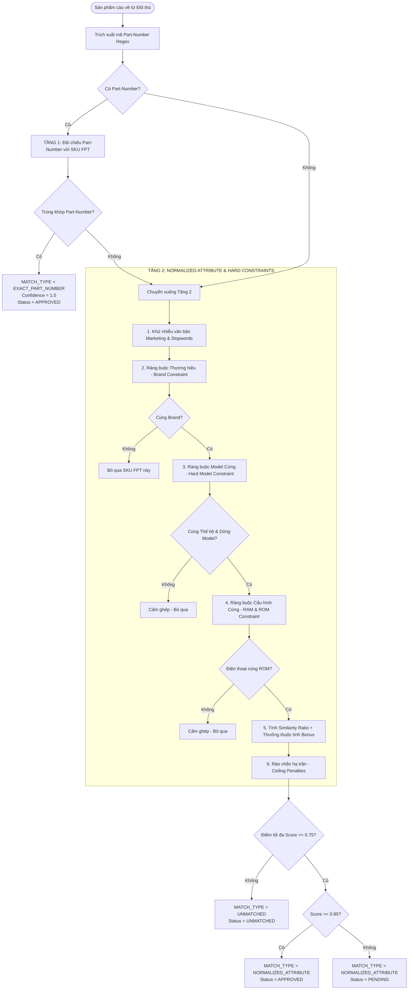
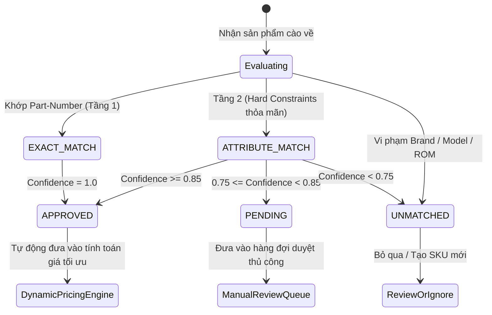

> **Mục lục trung tâm:** [[Dynamic Pricing Index]] | **Tổng quan:** [[Project Overview]]
> **Tài liệu liên quan:** [[Hiểu code cào dữ liệu và map sku]] | [[Khám phá Dữ liệu & Ma trận Định giá]] | [[Thiết kế Cơ sở Dữ liệu Toàn diện]] | [[Crawling & SKU Matcher Guide]]

# TÀI LIỆU ĐẶC TẢ TIÊU CHÍ MATCHING SKU (SKU MATCHING CRITERIA SPECIFICATION)

> **Module phụ trách:** [`app/services/sku_matcher.py`](file:///c:/Users/nguye/OneDrive/Desktop/Du_an/dynamic-priciing/app/services/sku_matcher.py) (`SkuMatcher`) 
> **Kiểm thử tự động:** [`tests/test_sku_matcher.py`](file:///c:/Users/nguye/OneDrive/Desktop/Du_an/dynamic-priciing/tests/test_sku_matcher.py) 
> **Tài liệu liên quan trong Knowledge Base:** 
> - [[Hiểu code cào dữ liệu và map sku]] 
> - [[Khám phá Dữ liệu & Ma trận Định giá]] 
> - [[Thiết kế Cơ sở Dữ liệu Toàn diện]] 
> - [[Giải thích Kiến trúc Backend và Chi tiết Codebase]] 
> - [[Dynamic Pricing Index]] 

---

## 1. TỔNG QUAN & TRIẾT LÝ THIẾT KẾ (DESIGN PHILOSOPHY)

### 1.1. Bối cảnh & Thách thức Nghiệp vụ
Trong hệ thống **Định giá Động (Dynamic Pricing)** cho ngành bán lẻ ICT (Điện thoại, Laptop, Tablet), việc so sánh giá giữa FPT Shop và các đối thủ cạnh tranh (như CellphoneS, Hoàng Hà Mobile) phụ thuộc 100% vào việc **ghép đúng cặp sản phẩm tương đương (SKU Mapping)**.

Tuy nhiên, mỗi hệ thống bán lẻ có quy chuẩn đặt tên sản phẩm tự do và rất khác nhau:
- **FPT Shop (Chuẩn):** `Laptop Acer Aspire 7 Gaming A715-59G-57TU i5 12450H/16GB/512GB/4GB RTX 2050/15.6"FHD/Win 11`
- **Hoàng Hà Mobile:** `Acer Aspire 7 A715-59G-57TU - Chính Hãng`
- **CellphoneS:** `Laptop Acer Aspire 7 A715-59G-57TU (Core i5-12450H, RTX 2050 4GB, RAM 16GB, SSD 512GB, 15.6 inch FHD)`
- **Điện thoại Apple:**
 - FPT: `iPhone 16 128GB`
 - Đối thủ: `Điện thoại Apple iPhone 16 128GB - Chính hãng VN/A (Đã kích hoạt)`

**Rủi ro nghiêm trọng:** Nếu áp dụng các giải pháp so khớp xâu ký tự thuần túy (Fuzzy Matching, Levenshtein, Cosine TF-IDF) mà không có ràng buộc phân tầng:
1. **Lệch cấu hình:** Ghép nhầm iPhone 16 bản `128GB` sang bản `256GB` (dẫn đến thuật toán tưởng FPT bán đắt hơn 3-5 triệu đồng).
2. **Lệch thế hệ (Wrong Generation):** Ghép nhầm `iPhone 18` vào `iPhone 14/16` do độ tương đồng chữ "iPhone" rất cao.
3. **Lệch dòng vi xử lý/Card đồ họa:** Ghép nhầm Laptop văn phòng với Laptop Gaming cùng thương hiệu.

### 1.2. Triết lý Phân tầng (Tiered Decision Architecture)
Tuân thủ nguyên tắc xử lý văn bản có cấu trúc (`regex-vs-llm-structured-text`), `SkuMatcher` áp dụng kiến trúc **2 tầng kiểm soát nghiêm ngặt**:



---

## 2. BẢNG TỔNG HỢP CÁC TIÊU CHÍ MATCHING (CRITERIA MATRIX)

| STT | Tên Tiêu chí | Cơ chế Kỹ thuật | Trọng số / Mức độ ảnh hưởng | Phạm vi áp dụng | Mục tiêu bảo vệ |
| :--- | :--- | :--- | :--- | :--- | :--- |
| **TC-01** | **Part-Number Match** | Regex Model Identifier của Hãng | Xác định 100% (Confidence = 1.0) | Laptop, Màn hình, PC | Ghép chính xác tuyệt đối cấu hình và lô hàng của nhà sản xuất |
| **TC-02** | **Brand Normalization** | Từ điển `BRAND_MAP` + Word Boundary | Ràng buộc phủ quyết (Veto Constraint) | Toàn bộ sản phẩm | Tuyệt đối không ghép chéo hãng (Apple $\leftrightarrow$ Samsung) |
| **TC-03** | **Hard Model Identifier** | Regex Thế hệ + Phân khúc biến thể | Ràng buộc phủ quyết + Thưởng (+0.15) | Smartphone, Laptop | Chống ghép sai thế hệ (iPhone 18 $\leftrightarrow$ 16, S25 $\leftrightarrow$ S24) |
| **TC-04** | **ROM/Storage Constraint** | Regex dung lượng (GB, TB) | Ràng buộc phủ quyết (Phone) + Thưởng (+0.10) | Toàn bộ thiết bị nhớ | Chống ghép lệch dung lượng ổ cứng (128GB $\leftrightarrow$ 256GB/512GB) |
| **TC-05** | **RAM Match** | Regex dung lượng RAM | Thưởng điểm (+0.10) | Laptop, Smartphone | Ưu tiên ghép đúng phiên bản RAM tương đương |
| **TC-06** | **Text Cleaning & Stopwords** | Regex thanh lọc chuỗi | Tiền xử lý chuẩn hóa chuỗi | Toàn bộ tên sản phẩm | Khử nhiễu các thuật ngữ marketing ("chính hãng", "đã kích hoạt", "5G",...) |
| **TC-07** | **SequenceMatcher Ratio** | Thuật toán Ratcliff-Obershelp | Điểm cơ sở ($0.0 \to 1.0$) | Tầng 2 | Đo độ tương đồng hình thái ký tự sau làm sạch |
| **TC-08** | **Conflict Part-Number Penalty** | Set Difference Check | Hạ trần tối đa xuống `0.79` | Sản phẩm có Part Number | Bắt buộc chuyển sang `PENDING` nếu 2 máy có mã con khác nhau |
| **TC-09** | **Generic Series Penalty** | Keyword Check (`"series"`) | Hạ trần tối đa xuống `0.79` | Tên sản phẩm chung | Ngăn tự động duyệt nếu tên đối thủ quá chung chung |

---

## 3. CHI TIẾT TỪNG TIÊU CHÍ KỸ THUẬT

### 3.1. Tiêu chí 1: Mã hiệu Part-Number (Tầng 1 - Exact Match)
Mã Part-Number (Mã phụ tùng / Model Code) là chuỗi ký tự duy nhất do nhà sản xuất (OEM) cấp cho một phiên bản cấu hình phần cứng cụ thể.

- **Thuật toán trích xuất (`extract_part_numbers`):**
 - **Pattern 1 (Phổ thông cho Acer, Asus, MSI, Dell, HP):**
 ```regex
 \b[A-Za-z0-9]{2,}-[A-Za-z0-9]{2,}(?:-[A-Za-z0-9]{2,})*\b
 ```
 *Ví dụ khớp:* `A715-59G-57TU`, `AN515-58-52SP`, `FA506NCG-HN329W`, `UX3407QA-QD299WS`, `B13VEK-2440VN`.
 - **Pattern 2 (Chuỗi Part Lenovo Type 8x):**
 ```regex
 \b8[0-9][A-Za-z0-9]{6,8}\b
 ```
 *Ví dụ khớp:* `83GS001RVN`, `83UQ003NVN`, `83RQ002PVN`.
 - **Điều kiện lọc rác:** Độ dài $\ge 6$ ký tự và bắt buộc phải chứa ít nhất 1 chữ số (`any(c.isdigit() for c in p)`).

- **Quy tắc Quyết định Tầng 1:**
 1. Nếu giao tập hợp: $\text{Set}(\text{Parts}_{\text{scraped}}) \cap \text{Set}(\text{Parts}_{\text{fpt}}) \neq \emptyset$.
 2. Hoặc Part-Number cào được là chuỗi con trong tên SKU FPT (`any(p in dim_name.upper() for p in scraped_parts)`).
 3. **Kết luận:**
 $$\text{Match Type} = \text{EXACT\_PART\_NUMBER}, \quad \text{Confidence} = 1.0, \quad \text{Status} = \text{APPROVED}$$

---

### 3.2. Tiêu chí 2: Chuẩn hóa & Ràng buộc Thương hiệu (Brand Constraint)
Hệ thống sử dụng bảng tra cứu chuẩn hóa `BRAND_MAP` kết hợp Regex Word Boundary (`\b`) để nhận diện thương hiệu gốc:

```python
BRAND_MAP = {
 "apple": "apple", "iphone": "apple", "macbook": "apple", "ipad": "apple",
 "samsung": "samsung", "galaxy": "samsung",
 "xiaomi": "xiaomi", "redmi": "xiaomi", "poco": "xiaomi",
 "oppo": "oppo", "vivo": "vivo", "realme": "realme", "tecno": "tecno",
 "acer": "acer", "asus": "asus", "lenovo": "lenovo", "dell": "dell",
 "hp": "hp", "msi": "msi", "honor": "honor"
}
```

- **Quy tắc kiểm tra:**
 $$\text{scraped\_brand} \neq \text{dim\_brand} \implies \text{LOẠI BỎ NGAY (Bỏ qua SKU FPT này)}$$
- *Ý nghĩa:* Dù tên sản phẩm có các từ vựng giống nhau (như "Ultra", "Plus", "Gaming", "16GB", "512GB"), nếu khác Brand thì độ tương đồng lập tức bị vô hiệu hóa.

---

### 3.3. Tiêu chí 3: Định danh Dòng máy & Thế hệ Cứng (Hard Model Identifier)
Đây là "bộ lọc an toàn" tối quan trọng được thiết kế để giải quyết triệt để lỗi ghép chéo đời máy (Generation Mismatch) trên điện thoại và laptop.

Hàm `extract_model_identifier(text)` phân loại thành các chuẩn định danh duy nhất:

#### A. Dòng Apple iPhone
- **Regex:** `\biphone\s*(\d+|se|x|xs|xr)\s*(pro\s*max|pro|plus|mini|e)?\b`
- **Output chuẩn hóa:** `iphone_{generation}_{variant}`
 - `iPhone 16 Pro Max` $\to$ `iphone_16_promax`
 - `iPhone 16` $\to$ `iphone_16_`
 - `iPhone 14 Plus` $\to$ `iphone_14_plus`
 - `iPhone SE 2022` $\to$ `iphone_se_`

#### B. Dòng Samsung Galaxy
- **Regex:** `\bgalaxy\s*(z\s*fold|z\s*flip|s|a|m)\s*(\d+)\s*(ultra|plus|fe|edge)?\b`
- **Output chuẩn hóa:** `samsung_{series}{number}_{variant}`
 - `Samsung Galaxy S24 Ultra` $\to$ `samsung_s24_ultra`
 - `Galaxy Z Fold6` $\to$ `samsung_zfold6_`
 - `Galaxy A55 5G` $\to$ `samsung_a55_`

#### C. Dòng Xiaomi / Redmi / Poco
- **Regex:** `\b(?:xiaomi\s+)?(redmi\s*note\s*\d+[a-z]?|redmi\s*\d+[a-z]?|poco\s*[a-z0-9]+|xiaomi\s*\d+[a-z]?)\b`
- **Output chuẩn hóa:** Thay thế khoảng trắng bằng dấu gạch dưới (VD: `redmi_note_13_pro`, `poco_x6_pro`, `xiaomi_14`).

#### D. Dòng Oppo
- **Regex:** `\boppo\s*(find\s*[a-z0-9]+|reno\s*[a-z0-9]+|a\s*\d+[a-z]?)\s*(ultra|pro|plus|fe|s)?\b`
- **Output chuẩn hóa:** `oppo_{series}_{variant}` (VD: `oppo_reno_12_pro`).

#### E. Danh mục Dòng Laptop định sẵn (`LAPTOP_LINES`)
Gồm 27 dòng sản phẩm định hình phân khúc:
`macbook air`, `macbook pro`, `macbook`, `aspire 7`, `aspire go`, `aspire lite`, `nitro v`, `nitro lite`, `nitro`, `predator`, `swift`, `vivobook go`, `vivobook s14`, `vivobook 14`, `vivobook`, `tuf gaming`, `rog strix`, `zenbook`, `ideapad slim`, `ideapad gaming`, `loq`, `legion`, `thinkbook`, `inspiron`, `vostro`, `latitude`, `pavilion`, `victus`, `omen`, `katana`.

#### F. Ràng buộc Đối xứng (Symmetric Generation Guard)
Đối với các thương hiệu Smartphone lớn (`apple`, `samsung`, `oppo`, `xiaomi`):
1. **Nếu 2 bên cùng bóc tách được model_id:**
 $$\text{scraped\_model\_id} \neq \text{dim\_model\_id} \implies \text{CẤM GHÉP (LOẠI BỎ)}$$
2. **Nếu một bên nhận diện được thế hệ cụ thể nhưng bên kia không nhận diện được:**
 $$(\text{scraped\_model\_id is True}) \oplus (\text{dim\_model\_id is True}) \implies \text{CẤM GHÉP}$$
 *(Chống tình huống: Đối thủ ghi "iPhone 18" - không có trong danh mục FPT - bị ghép rơi vào "iPhone 16" hoặc "iPhone chung chung").*

---

### 3.4. Tiêu chí 4: Dung lượng ROM / Bộ nhớ trong (ROM Constraint)
- **Regex trích xuất:**
 - GB: `\b(64|128|256|512)\s*gb\b`
 - TB: `\b(1|2)\s*tb\b`
 - Chuẩn hóa: `128gb`, `256gb`, `512gb`, `1tb`, `2tb`.
- **Ràng buộc cứng cho Smartphone:**
 $$\text{Nếu cả 2 bên đều có thông số ROM và } \text{Set}(\text{ROM}_{\text{scraped}}) \neq \text{Set}(\text{ROM}_{\text{fpt}}) \implies \text{CẤM GHÉP}$$
 - *Ví dụ:* `iPhone 16 128GB` tuyệt đối không bao giờ được ghép với `iPhone 16 256GB`.
- **Thưởng điểm (Attribute Bonus):**
 - Trùng khớp hoàn toàn ROM: $\text{Bonus}_{\text{ROM}} = +0.10$.

---

### 3.5. Tiêu chí 5: Dung lượng Bộ nhớ RAM (RAM Bonus)
- **Regex trích xuất:** `\b(4|6|8|12|16|24|32)\s*gb\b`
- **Áp dụng:** Phổ biến trên Laptop và các dòng Android nhiều cấu hình RAM.
- **Thưởng điểm:**
 - Nếu cả 2 bên đều có RAM và trùng nhau: $\text{Bonus}_{\text{RAM}} = +0.10$.

---

### 3.6. Tiêu chí 6: Khử nhiễu Văn bản & Từ khóa Marketing (Text Cleaning)
Hàm `clean_product_name(text)` loại bỏ triệt để các yếu tố gây sai lệch trọng số xâu ký tự:
- **Xóa các cụm từ chứng nhận/quảng cáo:**
 - `\|\s*chính hãng\s*(?:vn/a)?`
 - Stopwords: `điện thoại`, `laptop`, `máy tính xách tay`, `máy tính bảng`, `chính hãng`, `vn/a`, `đã kích hoạt`, `cũ đẹp`, `đổi trả`, `5g`, `4g`, `lte`, `mới 100%`, `new`.
- **Chuẩn hóa ký tự phân cách:** Đổi `[-–|/]` thành khoảng trắng.
- **Thu gọn khoảng trắng dư thừa:** `re.sub(r"\s+", " ", t).strip()`.

---

## 4. CÔNG THỨC TÍNH ĐIỂM & MA TRẬN PHÂN TẦNG QUYẾT ĐỊNH

### 4.1. Công thức Tính Điểm Tổng hợp (Confidence Score Formula)
Tại Tầng 2, điểm tin cậy tổng thể được tổng hợp từ điểm hình thái ký tự và các điểm thưởng cấu hình:

$$\text{Base Ratio} = \text{SequenceMatcher}(\text{text}_{\text{clean\_scraped}}, \text{text}_{\text{clean\_fpt}}).\text{ratio}()$$

$$\text{Total Bonus} = \text{Bonus}_{\text{RAM}} (0.10) + \text{Bonus}_{\text{ROM}} (0.10) + \text{Bonus}_{\text{Model}} (0.15)$$

$$\text{Initial Score} = \min(0.95, \text{Base Ratio} + \text{Total Bonus})$$

### 4.2. Rào chắn Hạ trần (Ceiling Penalties & Safety Guards)
Sau khi có `Initial Score`, hệ thống áp dụng các kiểm tra an toàn để giáng cấp nếu phát hiện dấu hiệu bất thường:

1. **Phạt xung đột Part-Number:**
 Nếu cả sản phẩm cào về và sản phẩm FPT **đều có Part-Number** nhưng không trùng nhau:
 $$\text{Final Score} = \min(\text{CONFIDENCE\_PENDING\_CEILING}, \text{Initial Score}) = \min(0.79, \text{Initial Score})$$
 *(Ý nghĩa: Đây là 2 máy cùng series nhưng khác mã màu hoặc khác chip sub-version. Không cho phép tự động Approved, phải đưa về PENDING).*
2. **Phạt danh mục chung chung (Generic Series Name):**
 Nếu tên làm sạch chứa chữ `"series"` (VD: "Asus Zenbook Series"):
 $$\text{Final Score} = \min(0.79, \text{Initial Score})$$

---

### 4.3. Ngưỡng Quyết định & Vòng đời Trạng thái (Status Lifecycle)



| Trạng thái | Ngưỡng Điểm (Confidence Score) | Định danh Loại khớp (`match_type`) | Hành vi Hệ thống |
| :--- | :--- | :--- | :--- |
| **`APPROVED`** | `Confidence >= 0.85` (hoặc `1.0`) | `EXACT_PART_NUMBER` hoặc `NORMALIZED_ATTRIBUTE` | **Tự động phê duyệt.** Giá đối thủ được nạp thẳng vào thuật toán Dynamic Pricing tính giá tối ưu. |
| **`PENDING`** | `0.75 <= Confidence < 0.85` | `NORMALIZED_ATTRIBUTE` | **Chờ duyệt.** Xuất hiện trên bảng điều khiển để chuyên viên định giá (Pricing Specialist) click duyệt hoặc gán lại. |
| **`UNMATCHED`** | `Confidence < 0.75` hoặc vi phạm rào cản | `UNMATCHED` | **Không khớp.** Gán SKU ID là `"N/A"`, không đối soát giá để chống ô nhiễm dữ liệu. |
| **`NOT_FOUND`** | `0.0` | `NOT_FOUND` | Áp dụng trong chế độ báo cáo `master_by_fpt = True` khi 1 SKU FPT hoàn toàn vắng bóng đối thủ cạnh tranh trên thị trường. |

---

## 5. TIÊU CHÍ ĐỐI SOÁT & TÍNH TOÁN BIẾN ĐỘNG GIÁ (PRICE VARIANCE)

Khi một sản phẩm được ghép cặp thành công (`status in ['APPROVED', 'PENDING']`), hệ thống tự động kích hoạt tiêu chí so sánh giá:

### 5.1. Nguồn Dữ liệu Giá Tham chiếu FPT
- **Tệp nguồn:** `data/demand_events_20260723.xlsx`.
- **Công thức:** Giá trung vị (Median Price) theo từng `sku_id` FPT trong tập giao dịch gần nhất:
 $$P_{\text{FPT}} = \text{Median}(\text{price\_at\_event})_{\text{sku\_id}}$$

### 5.2. Công thức Độ lệch Giá (Price Variance Metrics)
1. **Độ lệch giá tuyệt đối (VND):**
 $$\Delta P_{\text{VND}} = P_{\text{FPT}} - P_{\text{Competitor}}$$
 - $\Delta P_{\text{VND}} > 0$: FPT đang bán đắt hơn đối thủ (Cần kích hoạt chiến lược hạ giá cạnh tranh).
 - $\Delta P_{\text{VND}} < 0$: FPT đang bán rẻ hơn đối thủ.
2. **Độ lệch phần trăm (%):**
 $$\Delta P_{\%} = \left( \frac{P_{\text{FPT}} - P_{\text{Competitor}}}{P_{\text{FPT}}} \right) \times 100\%$$

---

## 6. VÍ DỤ MINH HỌA THỰC TẾ (CASE STUDIES)

### Case 1: Khớp Tầng 1 - Part-Number chính xác 100%
- **Đối thủ (Hoàng Hà):** `Acer Aspire 7 A715-59G-57TU - Chính Hãng (19,990,000 đ)`
- **FPT Master SKU:** `Laptop Acer Aspire 7 Gaming A715-59G-57TU i5 12450H/16GB/512GB (21,590,000 đ)`
- **Xử lý:**
 - Part-number trích xuất: `A715-59G-57TU`.
 - Cả 2 bên đều chứa Part-Number này $\implies$ Giao tập hợp $\neq \emptyset$.
- **Kết quả:**
 - `fpt_sku_id`: `SKU_ACER_NITRO`
 - `match_type`: `EXACT_PART_NUMBER`
 - `confidence_score`: `1.0`
 - `status`: `APPROVED`
 - `price_diff_vnd`: `+1,600,000 đ` ($\Delta P_{\%} = +7.4\%$).

### Case 2: Chặn Lệch Thế hệ (iPhone 18 vs iPhone 14/16)
- **Đối thủ:** `Điện thoại Apple iPhone 18 Pro Max 256GB Chính hãng`
- **FPT Master:** Danh mục FPT hiện chỉ có đến `iPhone 16 Pro Max 256GB`.
- **Xử lý:**
 - Model đối thủ: `iphone_18_promax`.
 - Model FPT: `iphone_16_promax`.
 - Vi phạm Hard Model Constraint: `iphone_18_promax != iphone_16_promax`.
- **Kết quả:**
 - **BỊ CHẶN NGAY LẬP TỨC.**
 - `match_type`: `UNMATCHED`
 - `fpt_sku_id`: `"N/A"`
 - `status`: `UNMATCHED`

### Case 3: Chặn Lệch Dung lượng ROM trên Smartphone
- **Đối thủ:** `iPhone 16 256GB Chính hãng VN/A (24,500,000 đ)`
- **FPT SKU đang xét:** `iPhone 16 128GB (21,990,000 đ)`
- **Xử lý:**
 - Cùng model: `iphone_16_`.
 - Đối thủ ROM: `{'256gb'}`, FPT ROM: `{'128gb'}`.
 - Vi phạm ROM Constraint của Smartphone: `{'256gb'} != {'128gb'}`.
- **Kết quả:** Bỏ qua SKU 128GB, tiếp tục tìm kiếm và khớp đúng vào SKU FPT `iPhone 16 256GB` với trạng thái `APPROVED`.

### Case 4: Mâu thuẫn Part-Number (Hạ trần PENDING)
- **Đối thủ:** `Laptop Lenovo LOQ 15IAX9 83GS001RVN`
- **FPT SKU:** `Laptop Lenovo LOQ 15IAX9 83GS001TVN`
- **Xử lý:** Cùng dòng `Lenovo LOQ 15IAX9`, nhưng Part-Number khác nhau (`83GS001RVN` vs `83GS001TVN`).
- **Kết quả:**
 - `score` bị kéo xuống trần `min(0.79, score) = 0.79`.
 - `status`: `PENDING` (Chuyển sang hàng đợi nhân viên thẩm định cấu hình card đồ họa/màu sắc).

---

## 7. TỐI ƯU HIỆU NĂNG KỸ THUẬT (PERFORMANCE OPTIMIZATION)

Khi danh mục FPT mở rộng lên hàng nghìn SKU và dữ liệu cào đối thủ lên hàng vạn bản ghi:
1. **Precomputing Danh mục FPT (`_precompute_fpt_skus`):**
 - Khi khởi tạo class `SkuMatcher`, toàn bộ Part-Number, Brand, Model ID, RAM, ROM của 329+ SKU FPT được tính toán trước 1 lần duy nhất trong RAM dưới dạng `List[Dict[str, Any]]`.
 - Giảm độ phức tạp từ $\mathcal{O}(M \times N \times \text{Cost}_{\text{Regex}})$ xuống $\mathcal{O}(M \times \mathcal{O}(1) + M \times N \times \text{Cost}_{\text{Compare}})$.
2. **Fast Pruning (Tỉa nhánh sớm):**
 - Lọc nhanh theo Brand trước khi chạy so khớp xâu ký tự tốn kém.
 - Nếu lệch Brand hoặc lệch Model cứng $\to$ lệnh `continue` ngắt vòng lặp ngay lập tức ở microsecond đầu tiên.
3. **Báo cáo chuẩn hóa Excel 2 Sheet qua [`ExcelExporter`](file:///c:/Users/nguye/OneDrive/Desktop/Du_an/dynamic-priciing/app/utils/excel_exporter.py):**
 - Sheet 1: `Scraped_All_Data` (Toàn bộ dữ liệu thô cào về).
 - Sheet 2: `SKU_Mapping` (Kết quả ánh xạ SKU, độ tin cậy, trạng thái và chênh lệch giá).
