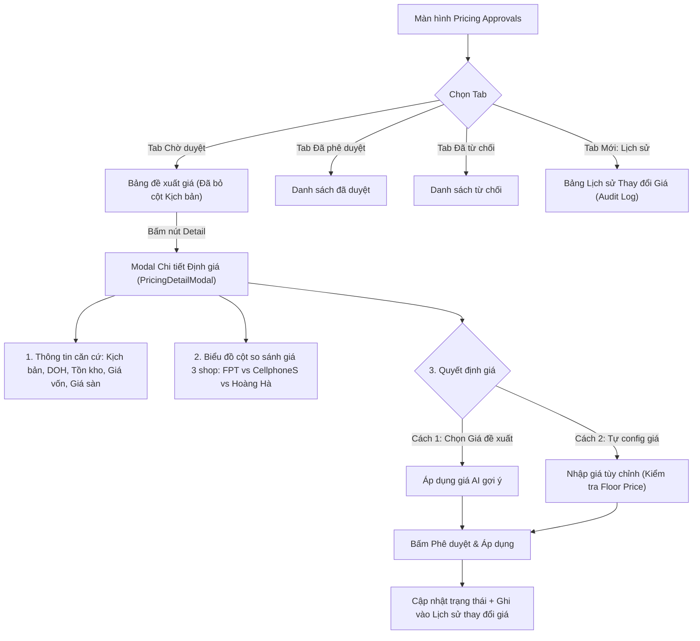

# Kế hoạch Triển khai Cải tiến Màn hình Duyệt giá (Pricing Approvals)

> **Dành cho Agentic Workers:** Yêu cầu tuân thủ workflow lập kế hoạch, kiểm tra độ an toàn trước khi chỉnh sửa và xác nhận từ người dùng trước khi tiến hành viết mã nguồn.

**Mục tiêu:** Nâng cấp trải nghiệm người dùng trên màn hình Duyệt giá (**Pricing Approvals**) theo 4 yêu cầu nghiệp vụ:
1. Thêm màn hình **Lịch sử thay đổi giá** (Price Change History / Audit Log).
2. **Loại bỏ cột Kịch bản & Căn cứ** trên bảng chính để bảng tinh gọn, tập trung vào số liệu giá.
3. Thêm nút **Detail** cho từng sản phẩm: khi nhấp sẽ mở Modal chi tiết gồm **thông tin căn cứ định giá** và **biểu đồ cột trực quan mức giá của 3 shop** (FPT Shop, CellphoneS, Hoàng Hà Mobile).
4. Tại Modal Detail, cho phép linh hoạt: **Chọn dùng giá đề xuất** hoặc **Tự cấu hình (config) giá mới** với chốt chặn an toàn giá sàn (**Floor Price Guard**).

**Kiến trúc giải pháp:**
- Giữ nguyên cấu trúc Single-Page Application (React 18 + TypeScript + Tailwind CSS).
- Mở rộng hệ thống tab trong `PricingApprovalsPage` thêm tab `Lịch sử thay đổi giá` (`HISTORY`).
- Tách biệt component Modal chi tiết định giá (`PricingDetailModal.tsx`) và Bảng lịch sử (`PriceHistoryTable.tsx`) theo nguyên tắc Deep Modules & Single Responsibility.
- Dựng biểu đồ so sánh 3 shop bằng Tailwind CSS Flex/Bar Chart trực quan (FPT Shop cam `#F26F21`, CellphoneS đỏ `#EF4444`, Hoàng Hà xanh `#10B981`), tải siêu nhẹ, không phụ thuộc thư viện đồ họa cồng kềnh.

---

## 1. Yêu cầu Cần Xem xét (User Review Required)

> [!IMPORTANT]
> **Về việc hiển thị biểu đồ 3 shop trong Modal Detail:**
> Biểu đồ cột sẽ so sánh 3 mốc giá thị trường hiện tại:
> - **FPT Shop**: Giá bán hiện tại (kèm mốc giá mới dự kiến áp dụng).
> - **CellphoneS**: Giá cào mới nhất & trạng thái còn hàng.
> - **Hoàng Hà Mobile**: Giá cào mới nhất & trạng thái còn hàng.

> [!TIP]
> **Cơ chế kiểm soát an toàn giá sàn (Floor Price Guard) khi người dùng tự config giá:**
> Khi chuyên viên chọn *"Tự cấu hình giá"*, nếu nhập mức giá thấp hơn Giá sàn bảo vệ (`floor_price = cost_price * 1.05`), hệ thống sẽ:
> - Cảnh báo đỏ vi phạm biên lợi nhuận tối thiểu.
> - Yêu cầu xác nhận đặc biệt hoặc chặn áp dụng để ngăn ngừa bán lỗ dưới vốn.

---

## 2. Luồng Trải nghiệm Người dùng (User Flow)

---

## 3. Danh sách File Thay đổi và Bổ sung

### Layer 1: Data Models & API Adapters
#### [MODIFY] `frontend/src/types/pricing.ts`
- Bổ sung type tab mới: `export type ApprovalTabType = 'PENDING' | 'APPROVED' | 'REJECTED' | 'HISTORY';`
- Bổ sung interface `PriceChangeHistoryItem`:
  - `id`: string
  - `sku`: string
  - `product_name`: string
  - `old_price`: number
  - `new_price`: number
  - `price_change`: number (VND)
  - `price_change_percent`: number (%)
  - `change_type`: `'AI_RECOMMENDED' | 'MANUAL_CONFIG'`
  - `scenario`: string
  - `changed_by`: string (vd: "Pricing Analyst")
  - `changed_at`: string (ISO datetime)
  - `status`: `'APPLIED' | 'SYNCED_POS'`
- Bổ sung thông tin giá 3 shop trong `PricingRecommendation`:
  - `cellphones_price?: number;`
  - `cellphones_in_stock?: boolean;`
  - `hoangha_price?: number;`
  - `hoangha_in_stock?: boolean;`

#### [MODIFY] `frontend/src/api/mockData.ts`
- Cập nhật danh sách `mockRecommendations` bổ sung giá cụ thể của CellphoneS và Hoàng Hà Mobile.
- Bổ sung danh sách ban đầu `mockPriceHistory: PriceChangeHistoryItem[]` với các sự kiện mẫu (iPhone 16 Pro Max giảm 500k, ASUS Vivobook giảm 1tr1 do DOH cao, v.v.).

#### [MODIFY] `frontend/src/api/pricingApi.ts`
- Bổ sung hàm `getPriceHistoryApi(): Promise<PriceChangeHistoryItem[]>`
- Bổ sung hàm `applyCustomPriceApi(id: string, customPrice: number, changeType: 'AI_RECOMMENDED' | 'MANUAL_CONFIG'): Promise<void>`

---

### Layer 2: Components
#### [MODIFY] `frontend/src/components/recommendations/ApprovalFilterTabs.tsx`
- Hỗ trợ thêm tab thứ 4: `Lịch sử thay đổi giá` (Icon `History`, hiển thị số lượng bản ghi lịch sử).

#### [MODIFY] `frontend/src/components/recommendations/RecommendationTable.tsx`
- **Loại bỏ cột `Kịch bản & Căn cứ`** khỏi `<thead>` và `<tbody>`.
- Tại cột **Thao tác**, bổ sung nút **"Detail"** (kèm icon `Eye` / `BarChart3`) bên cạnh nút Duyệt nhanh / Từ chối.
- Bổ sung prop callback `onOpenDetail: (item: PricingRecommendation) => void`.

#### [NEW] `frontend/src/components/recommendations/PricingDetailModal.tsx`
Component Modal chuyên sâu chứa:
1. **Thông tin căn cứ định giá (Pricing Rationale)**:
   - Thẻ kịch bản chi tiết (Scenario badge & giải thích ngữ cảnh).
   - Chỉ số tồn kho & rủi ro: DOH (Số ngày tồn kho), Số lượng tồn thực tế.
   - Thước đo tài chính: Giá vốn (Cost), Giá sàn an toàn (Floor Cap 5% margin), Mức lãi gộp dự kiến.
2. **Biểu đồ cột trực quan giá 3 shop (3-Way Price Comparison Bar Chart)**:
   - Cột 1: **FPT Shop** (Giá hiện tại: 18.990.000đ)
   - Cột 2: **CellphoneS** (17.890.000đ - Còn hàng)
   - Cột 3: **Hoàng Hà Mobile** (17.990.000đ - Còn hàng)
   - Có mốc đường kẻ gióng giá sàn và hiển thị khoảng cách chênh lệch rõ ràng.
3. **Cơ chế chọn giá / Cấu hình giá**:
   - Radio 1: **Dùng giá đề xuất của hệ thống** (Hiển thị rõ mức giá gợi ý & margin).
   - Radio 2: **Tự cấu hình giá (Custom Price)**:
     - Ô input số tiền VND định dạng trực quan.
     - Tự động tính toán tức thời biên lợi nhuận % và chênh lệch so với đối thủ.
     - **Floor Price Guard**: Nếu giá nhập `< Floor Price`, hiện cảnh báo vi phạm giá sàn màu hồng đậm.
4. **Hành động**:
   - Nút **"Phê duyệt & Áp dụng"**: Ghi nhận giá mới vào hệ thống và bổ sung ngay vào Lịch sử thay đổi giá.
   - Nút **"Từ chối đề xuất"**.
   - Nút **"Đóng"**.

#### [NEW] `frontend/src/components/recommendations/PriceHistoryTable.tsx`
Bảng hiển thị toàn bộ nhật ký thay đổi giá:
- Thời gian áp dụng (HH:mm DD/MM/YYYY).
- Sản phẩm & SKU.
- Giá cũ $\rightarrow$ Giá mới (Kèm badge % tăng/giảm).
- Phương thức thay đổi (Badge xanh: `Đề xuất AI`, Badge cam: `Tự chỉnh tay`).
- Người phê duyệt (Pricing Analyst).
- Trạng thái đồng bộ POS/Website (`Đã đồng bộ`).

---

### Layer 3: Page Integration
#### [MODIFY] `frontend/src/pages/PricingApprovalsPage.tsx`
- Quản lý state cho tab mới `currentTab === 'HISTORY'`.
- Quản lý state modal: `selectedDetailItem: PricingRecommendation | null`.
- Quản lý danh sách `historyItems` (nạp từ API và cập nhật realtime khi duyệt giá trong Modal Detail hoặc duyệt nhanh ngoài bảng).
- Xử lý hành động phê duyệt tùy chỉnh (`handleApplyPriceFromDetail(id, finalPrice, changeType)`).

---

## 4. Kế hoạch Kiểm thử & Xác nhận (Verification Plan)

### Kiểm thử Tự động (Build & Typecheck):
- Chạy `cmd /c npm run build` để đảm bảo:
  - 0 lỗi TypeScript (Strict checking: noUnusedLocals, noUnusedParameters).
  - Bundle Vite đóng gói thành công.

### Kiểm thử Thủ công (Manual Test Flow):
1. **Kiểm tra Bảng duyệt giá**:
   - Xác nhận cột *Kịch bản & Căn cứ* đã biến mất hoàn toàn. Bảng hiển thị thông thoáng hơn.
   - Nút **Detail** xuất hiện tại cột Thao tác của từng dòng sản phẩm.
2. **Kiểm tra Modal Detail**:
   - Nhấp vào nút **Detail**: Modal bật lên mượt mà.
   - Quan sát phần thông tin căn cứ (Kịch bản, DOH, Tồn kho, Giá vốn, Giá sàn).
   - Quan sát **biểu đồ cột 3 shop**: Các thanh bar thể hiện đúng tỷ lệ mức giá FPT Shop, CellphoneS và Hoàng Hà Mobile.
   - Thử chọn radio *"Dùng giá đề xuất"* $\rightarrow$ Bấm Duyệt $\rightarrow$ Sản phẩm chuyển sang Đã duyệt.
   - Mở Detail sản phẩm khác, chọn *"Tự cấu hình giá"* $\rightarrow$ Nhập thử mức giá thấp hơn giá sàn $\rightarrow$ Kiểm tra cảnh báo Floor Price Guard $\rightarrow$ Nhập giá hợp lệ $\rightarrow$ Bấm Duyệt.
3. **Kiểm tra Màn hình Lịch sử Thay đổi Giá**:
   - Chuyển sang tab *"Lịch sử thay đổi giá"* $\rightarrow$ Xác nhận các lượt duyệt vừa thực hiện đã xuất hiện chính xác trong bảng nhật ký (kèm ghi chú Đề xuất AI hay Tự chỉnh tay).

---

## 5. Tiến độ Triển khai theo từng Task

- [ ] **Task 1**: Cập nhật Types (`ApprovalTabType`, `PriceChangeHistoryItem`, `competitor_prices`) và Mock Data/API.
- [ ] **Task 2**: Cập nhật `ApprovalFilterTabs` (Thêm tab Lịch sử) và xóa cột *Kịch bản & Căn cứ* trong `RecommendationTable`.
- [ ] **Task 3**: Xây dựng component `PriceHistoryTable.tsx` hiển thị nhật ký kiểm toán giá.
- [ ] **Task 4**: Xây dựng component `PricingDetailModal.tsx` (Thông tin căn cứ, Biểu đồ cột 3 shop, Toggle giá đề xuất/tự config, Floor Price Guard).
- [ ] **Task 5**: Tích hợp toàn diện vào `PricingApprovalsPage.tsx`, chạy build kiểm tra và kiểm thử giao diện thực tế.
