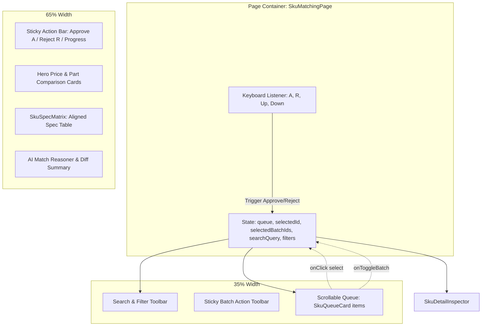

# SKU Mapping Master-Detail Split View Implementation Plan

> **For agentic workers:** REQUIRED SUB-SKILL: Use superpowers:executing-plans (Native execution) or superpowers:subagent-driven-development to implement this plan task-by-task. Steps use checkbox (`- [ ]`) syntax for tracking.

**Goal:** Redesign the SKU Mapping page (`SkuMatchingPage.tsx`) from a vertical stack of large cards into a high-productivity **Master-Detail Split View** (Option 1) featuring a 35% queue navigation pane on the left, a 65% deep diff inspector with an Aligned Spec Matrix on the right, global keyboard shortcuts (`A`, `R`, `↑`, `↓`), and batch review capabilities.

**Architecture:**
- **Container Page (`SkuMatchingPage.tsx`)**: Controls queue state, active item selection, filtering, batch selection set, and keyboard event listeners.
- **Left Pane (`SkuQueueList.tsx` & `SkuQueueCard.tsx`)**: Compact queue list with search bar, competitor & confidence filters, multi-select checkboxes, and a floating batch action toolbar.
- **Right Pane (`SkuDetailInspector.tsx` & `SkuSpecMatrix.tsx`)**: Focused inspector displaying sticky action buttons, hero price comparison cards, row-by-row aligned specifications table (highlighting matching vs differing specs), and AI/heuristic matching insights.

**Tech Stack:** React 18, TypeScript, Tailwind CSS, Lucide Icons, Vite.

---

## Global Constraints

- Must preserve existing API contracts (`getSkuMappingQueueApi`, `approveSkuMappingApi`, `rejectSkuMappingApi` in `frontend/src/api/pricingApi.ts`).
- Must support both Light and Dark modes seamlessly using Tailwind's `dark:` classes.
- Zero horizontal overflow; viewport height must fit comfortably inside `AppLayout` without double-page scrollbars (`h-[calc(100vh-130px)]` with independent scroll panes).
- TypeScript compile check (`npm.cmd run build`) must pass with 0 errors.

---

## Review Focus

1. **Auto-advance after action:** When the user approves or rejects an item (via click or `A`/`R` hotkey), the selection should smoothly advance to the next adjacent item in the queue.
2. **Keyboard focus isolation:** Hotkeys (`A`, `R`, `↑`, `↓`) must NOT trigger when typing in the search input box.
3. **Empty queue resilience:** When the last item is reviewed or filters yield 0 results, the inspector should show a friendly empty state instead of crashing on `undefined`.
4. **Missing or partial specs:** When either FPT or Competitor specs are partially missing or differently formatted, `SkuSpecMatrix` must align keys safely without throwing `undefined` errors.
5. **Batch review state cleanup:** After completing a batch approve or reject, the batch selection set must be cleared immediately.

---

## Architecture Diagram



---

## Proposed Changes

### Component 1: Mock Data Enrichment & Types

#### [MODIFY] `frontend/src/api/mockData.ts`
Add 3 additional realistic SKU mapping pairs (e.g. ASUS Vivobook OLED, iPhone 16 Pro Max, Dell Inspiron) with realistic specs and differing attributes to give sufficient queue volume for testing filters, search, and navigation.

---

### Component 2: Queue Navigation Pane (Left 35%)

#### [NEW] `frontend/src/components/mapping/SkuQueueCard.tsx`
- **Purpose**: Render a single compact queue card.
- **Visuals**:
  - Checkbox for multi-select.
  - Active selection indicator (orange-500 left border or glow ring).
  - FPT SKU & truncated product name.
  - Competitor badge (`CELLPHONES` / `HOANGHA`).
  - Confidence pill with colored meter (e.g. `74%`).
  - Price difference indicator (e.g. `-500.000 đ`).
  - Mini diff tags (e.g. `Màu`, `Mã Part`).

#### [NEW] `frontend/src/components/mapping/SkuQueueList.tsx`
- **Purpose**: Render the left pane containing:
  - Header with counter (`X sản phẩm chờ duyệt`).
  - Search input with clear button.
  - Quick filter pills:
    - Source filter: `Tất cả` | `CellphoneS` | `Hoàng Hà`.
    - Confidence filter: `Tất cả` | `70-79%` | `60-69%`.
  - Batch select header (`Chọn tất cả`) + Floating Batch Action Bar (`Duyệt X mục đã chọn`, `Từ chối X mục`).
  - Virtual/Scrollable list of `SkuQueueCard`.

---

### Component 3: Deep Diff Inspector (Right 65%)

#### [NEW] `frontend/src/components/mapping/SkuSpecMatrix.tsx`
- **Purpose**: Merge specs from FPT and Competitor into a side-by-side aligned comparison table.
- **Columns**:
  1. `Thuộc tính` (Attribute name, e.g. CPU, RAM, Ổ cứng, Màu sắc, Mã Part).
  2. `FPT Shop (Chuẩn)` (Value from FPT).
  3. `Đối thủ (Crawled)` (Value from competitor).
  4. `Trạng thái` (Badge/Icon: `Khớp` in emerald or `Khác biệt` in amber/rose).
- **Behavior**: Rows with differences are highlighted with subtle background tint for instant visual identification.

#### [NEW] `frontend/src/components/mapping/SkuDetailInspector.tsx`
- **Purpose**: Render the full details of the active selected SKU pair:
  - **Sticky Top Bar**:
    - SKU code, Product name, item position `#2 / 8`.
    - Quick Action Buttons:
      - `[✕ Từ chối (Phím R)]`
      - `[✓ Xác nhận khớp 100% (Phím A)]`
      - `[Mở trang đối thủ ↗]` (External link).
  - **Hero Price Comparison Section**:
    - Side-by-side cards comparing FPT base price vs Competitor price.
    - Difference badge showing exact VND gap and percentage.
  - **Aligned Spec Matrix (`SkuSpecMatrix`)**.
  - **AI / Heuristic Insight Card**:
    - Summarizes matched attributes (green badges).
    - Highlights differing attributes (amber badges).
    - Clear explanatory text explaining why manual review is needed.

---

### Component 4: Page Integration & Keyboard Shortcuts

#### [MODIFY] `frontend/src/pages/SkuMatchingPage.tsx`
- Redesign the layout into a 2-column flexbox:
  - Left pane: `w-full lg:w-[380px] xl:w-[420px] flex-shrink-0 border-r border-slate-200 dark:border-slate-800`.
  - Right pane: `flex-1 min-w-0 overflow-y-auto`.
  - Total container height: `h-[calc(100vh-135px)] overflow-hidden`.
- Implement Global Keyboard Event Listener (`useEffect`):
  - Ignore events if `event.target` is an `input` or `textarea`.
  - Key `a` / `A`: Approve currently active SKU.
  - Key `r` / `R`: Reject currently active SKU.
  - Key `ArrowUp`: Move selection to previous item in the filtered queue.
  - Key `ArrowDown`: Move selection to next item in the filtered queue.
- Implement Batch Actions:
  - `handleBatchApprove`: Calls approve API for each ID and removes them from the queue.
  - `handleBatchReject`: Calls reject API for each ID and removes them from the queue.
- Toast feedback: Displays a non-intrusive banner or toast when items are approved/rejected.

---

## Step-by-Step Implementation Tasks

### Task 1: Enrich Mock Data for Queue Testing
**Files:**
- Modify: `frontend/src/api/mockData.ts`
- Test: `npm.cmd run build`

- [ ] **Step 1:** Add 3 new SKU pairs in `mockMappingQueue` with diverse attributes (different competitors, different price gaps, varied specs).
- [ ] **Step 2:** Run `npm.cmd run build` to verify type compliance.

### Task 2: Build `SkuSpecMatrix` (Aligned Spec Comparison Table)
**Files:**
- Create: `frontend/src/components/mapping/SkuSpecMatrix.tsx`
- Test: `npm.cmd run build`

- [ ] **Step 1:** Implement attribute normalization and union of `fpt_specs` and `competitor_specs`.
- [ ] **Step 2:** Render 4-column aligned table with match/differ indicators and highlighted rows.
- [ ] **Step 3:** Run `npm.cmd run build` to verify compile without errors.

### Task 3: Build `SkuQueueCard` and `SkuQueueList`
**Files:**
- Create: `frontend/src/components/mapping/SkuQueueCard.tsx`
- Create: `frontend/src/components/mapping/SkuQueueList.tsx`
- Test: `npm.cmd run build`

- [ ] **Step 1:** Implement `SkuQueueCard` with multi-select checkbox, confidence badge, active highlight ring, and diff tags.
- [ ] **Step 2:** Implement `SkuQueueList` with search input, source/confidence filter pills, batch selection checkbox, and sticky batch action bar.
- [ ] **Step 3:** Run `npm.cmd run build` to verify compile.

### Task 4: Build `SkuDetailInspector`
**Files:**
- Create: `frontend/src/components/mapping/SkuDetailInspector.tsx`
- Test: `npm.cmd run build`

- [ ] **Step 1:** Implement sticky top action bar with keyboard shortcut tags (`Kbd`).
- [ ] **Step 2:** Integrate hero price cards, `SkuSpecMatrix`, and AI match explanation.
- [ ] **Step 3:** Run `npm.cmd run build` to verify compile.

### Task 5: Integrate Split View & Keyboard Shortcuts in `SkuMatchingPage`
**Files:**
- Modify: `frontend/src/pages/SkuMatchingPage.tsx`
- Test: `npm.cmd run build`

- [ ] **Step 1:** Reorganize `SkuMatchingPage` into responsive two-column Split View container.
- [ ] **Step 2:** Wire up selection state, search query, filter states, and batch selection set.
- [ ] **Step 3:** Implement keyboard shortcuts (`A`, `R`, `ArrowUp`, `ArrowDown`) with text input guard.
- [ ] **Step 4:** Add smooth auto-advance to next item when active item is approved/rejected.
- [ ] **Step 5:** Run `npm.cmd run build` to verify production build.

---

## Verification Plan

### Automated Build Verification
Run in `frontend/`:
```powershell
npm.cmd run build
```
Expected output: Vite builds successfully with 0 TypeScript errors and 0 lint warnings.

### Manual Verification in Browser
1. **Layout & Responsiveness**:
   - Navigate to `/` -> Click tab **"SKU Mapping"**.
   - Check that left pane (Queue List) and right pane (Detail Inspector) fit inside the viewport with independent scrolling and no global page scrollbar.
2. **Interactive Selection**:
   - Click different items in the left list. Verify the right pane updates instantly with the corresponding product specs and diff matrix.
3. **Aligned Spec Matrix**:
   - Verify that matched specs (e.g. CPU, RAM) show green checkmarks.
   - Verify that differing specs (e.g. Color, Part number) are highlighted in amber/rose.
4. **Keyboard Shortcuts**:
   - Press `↓` and `↑`: Active item changes in the queue.
   - Press `A`: Current item is approved, removed from queue, and selection moves to next item.
   - Press `R`: Current item is rejected, removed from queue, and selection moves to next item.
   - Type in the search box: Pressing `A` or `R` types the letter instead of triggering approval.
5. **Search & Filters**:
   - Type keyword (e.g. "Xiaomi" or "HP"): List filters in real time.
   - Click source filter pills ("CellphoneS", "Hoàng Hà"): List updates accurately.
6. **Batch Review**:
   - Check 2 items using the checkboxes.
   - Verify the Floating Batch Action Bar appears at the bottom of the list.
   - Click "Duyệt đã chọn": Both items are approved and removed from the queue.
