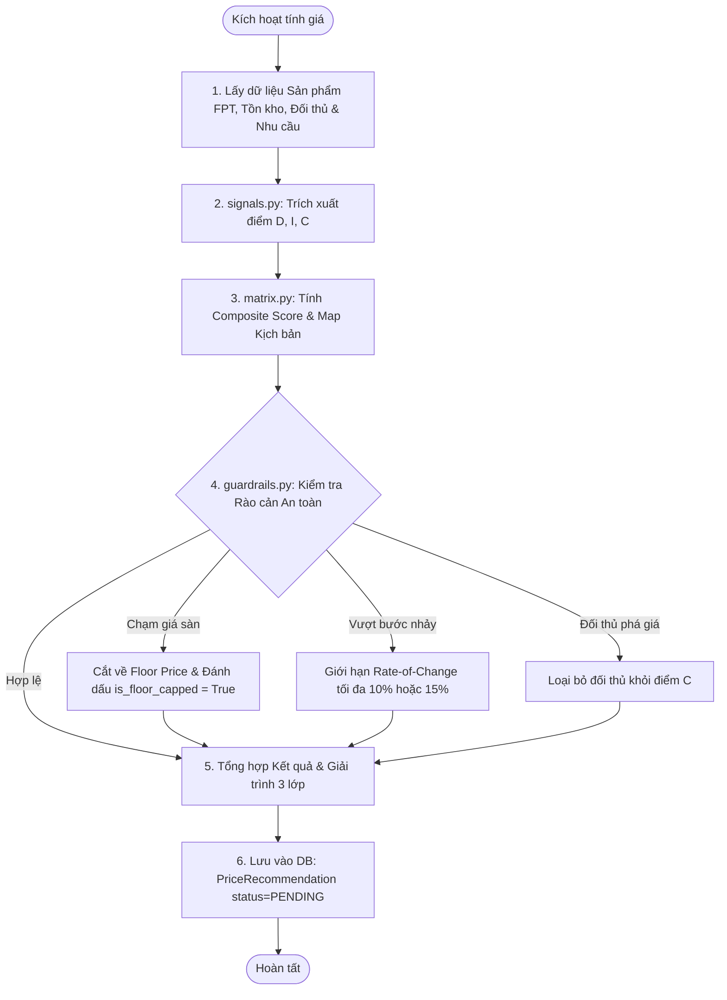

# Đặc Tả Thiết Kế Hệ Thống Động Cơ Gợi Ý Định Giá (Dynamic Pricing Recommendation Engine)

- **Ngày ban hành:** 2026-10-05
- **Trạng thái:** Approved
- **Tài liệu căn cứ:** `docs/obsidian-notes/Khám phá Dữ liệu & Ma trận Định giá.md`, `docs/obsidian-notes/Product Backlog – Dynamic Pricing.md` (PBI-010, PBI-011, PBI-012)
- **Tác giả:** Dynamic Pricing Engineering Team

---

## 1. Mục Tiêu & Phạm Vi (Goals & Scope)

### 1.1. Mục tiêu
Thiết kế và triển khai động cơ định giá động tự động hóa việc phân tích tín hiệu thị trường đa nguồn (Nhu cầu, Tồn kho, Đối thủ cạnh tranh) để sinh các khuyến nghị điều chỉnh giá tăng/giảm/giữ nguyên cho từng mã SKU FPT Shop. Cung cấp quy trình phê duyệt (Approval Workflow) giả lập và giải trình định lượng 3 lớp cho hệ thống RAG / Chuyên viên giá.

### 1.2. Ranh giới (In-Scope & Out-of-Scope)
- **In-Scope:**
  - Trích xuất và chuẩn hóa 3 nhóm tín hiệu $D, I, C \in [-2.0, +2.0]$ từ cơ sở dữ liệu.
  - Tính điểm Composite Score theo trọng số ngành hàng: $\text{Composite} = D \times 0.40 + I \times 0.35 + C \times 0.25$.
  - Phân loại vào 7 dải hành động điều chỉnh giá và ma trận 9 kịch bản nghiệp vụ chuẩn.
  - Áp dụng các rào cản kiểm soát an toàn (Circuit Breakers): Margin Floor, Rate-of-Change Cap, Predatory Pricing Filter.
  - Sinh cấu trúc giải trình 3 lớp (`reasoning_3layers` JSON).
  - Quản lý đề xuất giá (`PriceRecommendation`) và quy trình phê duyệt (`APPROVE`, `REJECT`) kèm nhật ký kiểm toán (`PricingAuditLog`).
  - Hệ thống API RESTful và bộ test kiểm thử tự động (Unit & Integration tests) theo chuẩn TDD.
- **Out-of-Scope:**
  - Ghi đè tự động trực tiếp lên hệ thống ERP/POS thật của chuỗi bán lẻ.
  - Giao diện người dùng Web Frontend (sẽ được triển khai trong Epic riêng sau khi hoàn tất Backend Engine).

---

## 2. Kiến Trúc Module & Luồng Dữ Liệu (Architecture & Data Flow)

### 2.1. Cấu trúc Thư mục Module
Toàn bộ logic nghiệp vụ định giá được tổ chức tại package `backend/app/services/pricing/`:

```text
backend/app/services/pricing/
├── __init__.py          # Export PricingEngine và các Data Class cốt lõi
├── schemas.py           # Internal DTOs / Dataclasses (SignalScores, RecommendationResult, PricingRulesConfig)
├── signals.py           # Trích xuất & chuẩn hóa điểm số D, I, C từ CSDL
├── matrix.py            # Bảng 7 Dải Hành Động, Ma trận 9 Kịch bản & tính Composite Score
├── guardrails.py        # Các chốt chặn an toàn: Margin Floor, Rate-of-Change Cap, Predatory Filter
└── engine.py            # Facade chính điều phối quy trình định giá
```

### 2.2. Luồng Dữ liệu (End-to-End Flow)



---

## 3. Đặc Tả Nghiệp Vụ & Toán Học (Business Logic & Scoring)

### 3.1. Danh mục Tín hiệu Thị trường ($D, I, C$)

1. **Demand Score ($D \in [-2.0, +2.0]$):**
   - Dựa trên [DemandEvent](file:///c:/Users/nguye/OneDrive/Desktop/Du_an/dynamic-priciing/backend/app/models/demand.py#L9-L29) và [DemandHourlyAggregate](file:///c:/Users/nguye/OneDrive/Desktop/Du_an/dynamic-priciing/backend/app/models/demand.py#L31-L47):
     - Lượt tìm kiếm tăng $>150\%$ hoặc CVR tăng $>30\% \implies D = +2.0$ (Surge).
     - Giỏ hàng / xem lại tăng $>50\% \implies D = +1.0$ (High).
     - Biến động bình thường $\implies D = 0.0$ (Neutral).
     - Bounce rate $>75\%$ hoặc CVR giảm $>25\% \implies D = -1.0$ (Low).
     - Tìm kiếm giảm $>50\%$ hoặc xóa giỏ hàng tăng đột biến $\implies D = -2.0$ (Critical Drop).

2. **Inventory Score ($I \in [-2.0, +2.0]$):**
   - Dựa trên [InventorySnapshot](file:///c:/Users/nguye/OneDrive/Desktop/Du_an/dynamic-priciing/backend/app/models/inventory.py#L38-L60) và [InventoryMock](file:///c:/Users/nguye/OneDrive/Desktop/Du_an/dynamic-priciing/backend/app/models/inventory.py#L9-L24):
     - Tồn kho khả dụng $<30\%$ target stock hoặc DOH $<7$ ngày hoặc đối thủ chính OOS $\implies I = +2.0$ (Khan hiếm nghiêm trọng).
     - Tồn kho $30\% \to 60\%$ target stock $\implies I = +1.0$ (Hơi khan).
     - Tồn kho ổn định $60\% \to 110\%$ target $\implies I = 0.0$ (Cân bằng).
     - Tồn kho $110\% \to 150\%$ target stock $\implies I = -1.0$ (Dư thừa nhẹ).
     - Tồn kho $>150\%$ target stock hoặc rủi ro lỗi thời `is_obsolescence_risk = True` hoặc DOH $>45$ ngày $\implies I = -2.0$ (Ứ đọng nặng).

3. **Competitor Score ($C \in [-2.0, +2.0]$):**
   - Dựa trên [CrawlResult](file:///c:/Users/nguye/OneDrive/Desktop/Du_an/dynamic-priciing/backend/app/models/crawl_result.py#L9-L35) qua [SKUMapping](file:///c:/Users/nguye/OneDrive/Desktop/Du_an/dynamic-priciing/backend/app/models/sku_mapping.py#L9-L31):
     - Giá đối thủ cao hơn FPT Shop $>15\%$ hoặc tất cả đối thủ đều OOS $\implies C = +2.0$.
     - Đối thủ cao hơn FPT Shop $5\% \to 15\% \implies C = +1.0$.
     - Đối thủ ngang bằng trong biên độ $\pm 5\% \implies C = 0.0$.
     - Đối thủ rẻ hơn FPT Shop $5\% \to 15\% \implies C = -1.0$.
     - Đối thủ rẻ hơn FPT Shop $>15\% \implies C = -2.0$.

### 3.2. Công Thức Composite Score & Bảng 7 Dải Hành Động

$$\text{Composite Score} = (D \times 0.40) + (I \times 0.35) + (C \times 0.25)$$

| Dải Điểm Composite | Tên Hành Động | Biên Độ Điều Chỉnh Mục Tiêu | Kịch Bản Điển Hình |
| :---: | :--- | :---: | :--- |
| $+1.50 \to +2.00$ | **Strong raise** | $+10\% \to +15\%$ | Kịch bản 1: Festival / Sự kiện lớn ($D=+2, I=+2, C=+2$) |
| $+0.75 \to +1.49$ | **Moderate raise** | $+4\% \to +10\%$ | Kịch bản 2: Sản phẩm Viral ($D=+2, I=0, C=0$), Kịch bản 8: Khan hàng nhưng đối thủ rẻ ($D=+2, I=+2, C=-2$) |
| $+0.25 \to +0.74$ | **Mild raise** | $+1\% \to +4\%$ | Kịch bản 5: Hàng khan, đối thủ hết nhưng cầu yếu ($D=-1, I=+2, C=+2$) |
| $-0.24 \to +0.24$ | **Hold** | $0\%$ | Kịch bản 3: Baseline ($D=0, I=0, C=0$), Kịch bản 4: Cầu cao nhưng hàng ứ ($D=+2, I=-2, C=0$) |
| $-0.74 \to -0.25$ | **Mild lower** | $-1\% \to -4\%$ | Bắt đầu bán chậm hoặc đối thủ giảm nhẹ |
| $-1.49 \to -0.75$ | **Moderate lower** | $-4\% \to -10\%$ | Kịch bản 7: Khách quay lưng, đối thủ rẻ ($D=-2, I=0, C=-2$) |
| $-2.00 \to -1.50$ | **Strong lower** | $-10\% \to -20\%$ | Kịch bản 6: Khủng hoảng nhu cầu ($D=-2, I=-2, C=-2$), Kịch bản Cuối vòng đời Clearance ($D=-2, I=-2, C=0$) |

### 3.3. Quy Tắc Rào Cản An Toàn (Safety Guardrails)

1. **Margin Floor:**
   - $\text{Floor Price} = \text{cost_price} \times (1 + \text{min_margin_pct})$ (hoặc lấy trực tiếp từ `inventory_mock.floor_price`).
   - Nếu $\text{recommended_price} < \text{Floor Price}$, bắt buộc gán $\text{recommended_price} = \text{Floor Price}$ và thiết lập cờ `is_floor_capped = True`.
2. **Rate-of-Change Cap:**
   - Giới hạn biên độ thay đổi tối đa $\pm 10\%$ đối với các kịch bản thông thường, tối đa $\pm 15\%$ đối với Strong Raise/Lower.
3. **Predatory Pricing Filter:**
   - Nếu giá đối thủ thấp hơn $>20\%$ so với giá vốn FPT Shop, gắn nhãn phá giá và cô lập dữ liệu đối thủ đó, không hạ giá theo.

---

## 4. Đặc Tả Giao Diện API & Schemas

### 4.1. Endpoints (`backend/app/api/v1/endpoints/pricing.py`)

- `POST /api/v1/pricing/recommendations/generate`
  - Body: `{ "fpt_product_id": Optional[UUID], "custom_weights": Optional[Dict[str, float]] }`
  - Response: Danh sách `PriceRecommendationResponse`
- `GET /api/v1/pricing/recommendations`
  - Query params: `status`, `scenario_name`, `is_floor_capped`, `skip`, `limit`
  - Response: `{ "total": int, "items": List[PriceRecommendationResponse] }`
- `GET /api/v1/pricing/recommendations/{id}`
  - Response: `PriceRecommendationResponse` chi tiết kèm audit logs
- `POST /api/v1/pricing/recommendations/{id}/action`
  - Body: `{ "action": "APPROVE" | "REJECT", "reviewed_by": str, "rejection_reason": Optional[str] }`
  - Response: `PriceRecommendationResponse` cập nhật
- `GET /api/v1/pricing/audit-logs`
  - Query params: `entity_id`, `actor`, `skip`, `limit`
  - Response: `{ "total": int, "items": List[PricingAuditLogResponse] }`

---

## 5. Chiến Lược Kiểm Thử (Testing & TDD)

- **Nguyên tắc TDD:** Viết test trước tại `backend/tests/test_pricing_*.py` để xác lập các ca kiểm thử thất bại (Red), sau đó phát triển code (Green) và tinh gọn (Refactor).
- **Bộ test bao gồm:**
  - `test_pricing_signals.py`: Đảm bảo điểm $D, I, C$ được tính chính xác theo các ngưỡng quy định.
  - `test_pricing_matrix.py`: Đảm bảo 9 kịch bản nghiệp vụ ánh xạ đúng $100\%$ theo ma trận chuẩn trong Obsidian.
  - `test_pricing_guardrails.py`: Đảm bảo chốt chặn giá sàn và ngưỡng hãm sốc giá hoạt động tin cậy.
  - `test_pricing_engine.py`: Đảm bảo quy trình tích hợp từ nạp dữ liệu đến sinh bản ghi đề xuất.
  - `test_pricing_api.py`: Đảm bảo các luồng HTTP API, kiểm soát trạng thái duyệt và ghi log kiểm toán.
- **Mục tiêu Coverage:** Đạt tối thiểu **80%** test coverage cho toàn bộ module `backend/app/services/pricing/` và `backend/app/api/v1/endpoints/pricing.py`.
