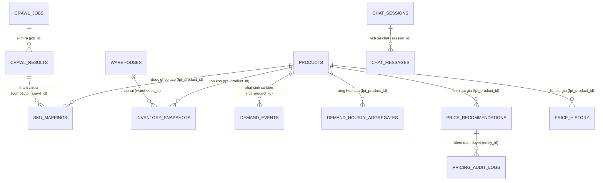

# Data Model & Schema Specification: Dynamic Pricing System

> **Branch:** `feature/database-architecture`
> **Domain Context:** `docs/obsidian-notes/Thiết kế Cơ sở Dữ liệu Toàn diện.md`
> **Target Database:** PostgreSQL 16+ (Production) / SQLite 3 (Local Development & CI)
> **ORM & Versioning:** SQLAlchemy 2.x + Alembic (`dbbe0db0b38f_expand_comprehensive_schema.py`)

---

## 1. Sơ đồ Quan hệ Thực thể Tổng thể (Entity-Relationship Diagram - ERD)

---

## 2. Kiến Trúc 7 Phân Hệ Nghiệp Vụ (7 Core Subsystems)

### Phân hệ 1: Ground Truth Catalog (`products`)
* **Bảng:** `products`
* **Mục đích:** Lưu trữ 329 SKU chuẩn của FPT Shop làm thước đo đối soát thị trường.
* **Các trường dữ liệu:**
  - `id`: GUID (Primary Key)
  - `sku`: VARCHAR(100), UNIQUE, NOT NULL, INDEX
  - `name`: VARCHAR(255), NOT NULL, INDEX
  - `category`: VARCHAR(50), NOT NULL, INDEX (`PHONE` | `LAPTOP`)
  - `brand`: VARCHAR(100), NULLABLE, INDEX
  - `part_number`: VARCHAR(100), NULLABLE, INDEX
  - `specs`: JSON/JSONB, NULLABLE
  - `cost_price`: BIGINT, NOT NULL, DEFAULT 0 (Giá vốn VND)
  - `min_margin_pct`: FLOAT, NOT NULL, DEFAULT 5.0 (Biên sàn tối thiểu %)
  - `floor_price`: BIGINT, NOT NULL, DEFAULT 0 (Giá sàn bảo vệ = `cost_price * (1 + min_margin_pct/100)`)
  - `base_retail_price`: BIGINT, NOT NULL, DEFAULT 0 (Giá niêm yết bán lẻ gốc)
  - `is_active`: BOOLEAN, NOT NULL, DEFAULT TRUE
  - `created_at`, `updated_at`: TIMESTAMP WITH TIME ZONE
* **Indexes:**
  - `uq_products_sku` (UNIQUE)
  - `ix_products_part_number` (B-tree phục vụ Tier 1 Exact Matching)
  - `ix_products_category_brand` (Composite Index)

---

### Phân hệ 2: Competitor Crawling & Job Governance (`crawl_jobs`, `crawl_results`)
* **Bảng:** `crawl_jobs`
  - `id`: GUID (Primary Key)
  - `trigger_type`: VARCHAR(30), NOT NULL (`SCHEDULED` | `ON_DEMAND`)
  - `source`: VARCHAR(50), NOT NULL (`CELLPHONES` | `HOANGHA` | `FPTSHOP` | `ALL`)
  - `category`: VARCHAR(50), NOT NULL (`PHONE` | `LAPTOP` | `ALL`)
  - `status`: VARCHAR(30), NOT NULL, INDEX (`PENDING` | `RUNNING` | `COMPLETED` | `FAILED`)
  - `total_items`, `success_items`, `error_items`: INTEGER, NOT NULL, DEFAULT 0
  - `error_log`: TEXT, NULLABLE
  - `started_at`: TIMESTAMP WITH TIME ZONE, NOT NULL
  - `finished_at`: TIMESTAMP WITH TIME ZONE, NULLABLE
* **Bảng:** `crawl_results`
  - `id`: GUID (Primary Key)
  - `job_id`: GUID (Foreign Key -> `crawl_jobs.id`), NULLABLE, INDEX
  - `source`: VARCHAR(50), NOT NULL, INDEX
  - `url`: VARCHAR(1000), NOT NULL
  - `raw_name`: VARCHAR(255), NOT NULL, INDEX
  - `current_price`: BIGINT, NULLABLE
  - `original_price`: BIGINT, NULLABLE
  - `is_in_stock`: BOOLEAN, NOT NULL, DEFAULT TRUE
  - `stock_status_text`: VARCHAR(100), NULLABLE
  - `raw_specs`: JSON/JSONB, NULLABLE
  - `crawled_at`: TIMESTAMP WITH TIME ZONE, NOT NULL, INDEX
* **Indexes:**
  - `ix_crawl_results_source_crawled_at` (Composite: `(source, crawled_at DESC)`)

---

### Phân hệ 3: Two-Tier SKU Matching Engine (`sku_mappings`)
* **Bảng:** `sku_mappings`
  - `id`: GUID (Primary Key)
  - `fpt_product_id`: GUID (Foreign Key -> `products.id`), NOT NULL, INDEX
  - `competitor_crawl_id`: GUID (Foreign Key -> `crawl_results.id`), NOT NULL, INDEX
  - `match_type`: VARCHAR(50), NOT NULL (`EXACT_PART_NUMBER` | `NORMALIZED_ATTRIBUTE` | `MANUAL`)
  - `confidence_score`: FLOAT, NOT NULL, CHECK (0.0 <= score <= 1.0)
  - `status`: VARCHAR(50), NOT NULL, DEFAULT 'APPROVED', INDEX (`APPROVED` | `PENDING` | `REJECTED`)
  - `matched_at`: TIMESTAMP WITH TIME ZONE, NOT NULL
  - `reviewed_by`: VARCHAR(100), NULLABLE
  - `reviewed_at`: TIMESTAMP WITH TIME ZONE, NULLABLE

---

### Phân hệ 4: Multi-Warehouse Inventory (`warehouses`, `inventory_snapshots`, `inventory_mock`)
* **Bảng:** `warehouses`
  - `warehouse_id`: VARCHAR(50), PRIMARY KEY (`WH-HN-01`, `WH-HCM-01`, `WH-DN-01`)
  - `warehouse_name`: VARCHAR(100), NOT NULL
  - `region`: VARCHAR(50), NOT NULL (`NORTH`, `SOUTH`, `CENTRAL`)
* **Bảng:** `inventory_snapshots`
  - `id`: GUID (Primary Key)
  - `fpt_product_id`: GUID (Foreign Key -> `products.id`), NOT NULL, INDEX
  - `warehouse_id`: VARCHAR(50) (Foreign Key -> `warehouses.warehouse_id`), NOT NULL, INDEX
  - `snapshot_ts`: TIMESTAMP WITH TIME ZONE, NOT NULL, INDEX
  - `qty_on_hand`: INTEGER, NOT NULL, DEFAULT 0
  - `qty_reserved`: INTEGER, NOT NULL, DEFAULT 0
  - `qty_available`: INTEGER, NOT NULL, DEFAULT 0
  - `target_stock`: INTEGER, NOT NULL, DEFAULT 0
  - `safety_stock`: INTEGER, NOT NULL, DEFAULT 0
  - `reorder_level`: INTEGER, NOT NULL, DEFAULT 0
  - `stock_cover_days`: INTEGER, NOT NULL, DEFAULT 0 (DOH - Days On Hand)
  - `is_obsolescence_risk`: BOOLEAN, NOT NULL, DEFAULT FALSE, INDEX
  - `holding_cost_pct_monthly`: FLOAT, NOT NULL, DEFAULT 1.5
  - `competitor_oos_count`: INTEGER, NOT NULL, DEFAULT 0

---

### Phân hệ 5: Realtime Demand Telemetry (`demand_events`, `demand_hourly_aggregates`)
* **Bảng:** `demand_events`
  - `event_id`: VARCHAR(100), PRIMARY KEY
  - `fpt_product_id`: GUID (Foreign Key -> `products.id`), NOT NULL, INDEX
  - `session_id`: VARCHAR(100), NOT NULL, INDEX
  - `user_id`: VARCHAR(100), NULLABLE, INDEX
  - `event_type`: VARCHAR(50), NOT NULL, INDEX (`view` | `search_click` | `cart_add` | `purchase`)
  - `event_ts`: TIMESTAMP WITH TIME ZONE, NOT NULL, INDEX
  - `time_on_page_sec`: INTEGER, NOT NULL, DEFAULT 0
  - `scroll_depth_pct`: INTEGER, NOT NULL, DEFAULT 0
  - `is_repeat_view`: BOOLEAN, NOT NULL, DEFAULT FALSE
  - `is_bounce`: BOOLEAN, NOT NULL, DEFAULT FALSE
  - `cart_action`: VARCHAR(50), NULLABLE
  - `search_keyword`: VARCHAR(255), NULLABLE
  - `exit_url_domain`: VARCHAR(255), NULLABLE
* **Bảng:** `demand_hourly_aggregates`
  - `id`: GUID (Primary Key)
  - `fpt_product_id`: GUID (Foreign Key -> `products.id`), NOT NULL, INDEX
  - `aggregate_hour`: TIMESTAMP WITH TIME ZONE, NOT NULL, INDEX
  - `total_views`, `search_clicks`, `cart_adds`, `purchases`: INTEGER, NOT NULL, DEFAULT 0
  - `cvr_pct`: FLOAT, NOT NULL, DEFAULT 0.0
  - `demand_score`: FLOAT, NOT NULL, DEFAULT 0.0

---

### Phân hệ 6: Dynamic Pricing Engine & Governance (`price_recommendations`, `price_history`, `pricing_audit_logs`)
* **Bảng:** `price_recommendations`
  - `id`: GUID (Primary Key)
  - `fpt_product_id`: GUID (Foreign Key -> `products.id`), NOT NULL, INDEX
  - `current_fpt_price`: BIGINT, NOT NULL
  - `competitor_min_price`: BIGINT, NULLABLE
  - `recommended_price`: BIGINT, NOT NULL
  - `price_delta_amount`: BIGINT, NOT NULL
  - `price_delta_pct`: FLOAT, NOT NULL
  - `demand_score`, `inventory_score`, `competitor_score`: FLOAT, NOT NULL
  - `composite_score`: FLOAT, NOT NULL, INDEX ($0.40D + 0.35I + 0.25C$)
  - `scenario_name`: VARCHAR(100), NOT NULL
  - `reasoning_3layers`: JSON/JSONB, NOT NULL (`{competitor_factor, inventory_factor, floor_protection_factor}`)
  - `is_floor_capped`: BOOLEAN, NOT NULL, DEFAULT FALSE
  - `status`: VARCHAR(30), NOT NULL, DEFAULT 'PENDING', INDEX (`PENDING` | `APPROVED` | `REJECTED`)
  - `reviewed_by`: VARCHAR(100), NULLABLE
  - `reviewed_at`: TIMESTAMP WITH TIME ZONE, NULLABLE
  - `rejection_reason`: VARCHAR(255), NULLABLE
  - `created_at`: TIMESTAMP WITH TIME ZONE, NOT NULL, INDEX
* **Bảng:** `price_history`
  - `id`: GUID (Primary Key)
  - `fpt_product_id`: GUID (Foreign Key -> `products.id`), NOT NULL, INDEX
  - `source`: VARCHAR(50), NOT NULL, INDEX (`FPTSHOP` | `CELLPHONES` | `HOANGHA`)
  - `price`: BIGINT, NOT NULL
  - `is_in_stock`: BOOLEAN, NOT NULL, DEFAULT TRUE
  - `recorded_at`: TIMESTAMP WITH TIME ZONE, NOT NULL, INDEX
  - *Composite Index:* `(fpt_product_id, source, recorded_at DESC)`
* **Bảng:** `pricing_audit_logs`
  - `id`: GUID (Primary Key)
  - `actor`: VARCHAR(100), NOT NULL
  - `action`: VARCHAR(50), NOT NULL (`APPROVE_PRICE` | `REJECT_PRICE` | `TRIGGER_CRAWL` | `APPROVE_MAPPING`)
  - `entity_type`: VARCHAR(50), NOT NULL
  - `entity_id`: GUID (Foreign Key -> `price_recommendations.id`), NULLABLE
  - `old_value`, `new_value`: JSON/JSONB, NULLABLE
  - `created_at`: TIMESTAMP WITH TIME ZONE, NOT NULL

---

### Phân hệ 7: RAG AI Assistant (`chat_sessions`, `chat_messages`)
* **Bảng:** `chat_sessions`
  - `id`: GUID (Primary Key)
  - `user_id`: VARCHAR(100), NULLABLE, INDEX
  - `title`: VARCHAR(255), NOT NULL, DEFAULT 'Cuộc hội thoại mới'
  - `created_at`, `updated_at`: TIMESTAMP WITH TIME ZONE
* **Bảng:** `chat_messages`
  - `id`: GUID (Primary Key)
  - `session_id`: GUID (Foreign Key -> `chat_sessions.id`), NOT NULL, INDEX
  - `role`: VARCHAR(20), NOT NULL (`user` | `assistant` | `system`)
  - `content`: TEXT, NOT NULL
  - `intent`: VARCHAR(50), NULLABLE (`PRICE_EXPLANATION` | `COMPETITOR_LOOKUP` | `INVENTORY_RISK`)
  - `retrieved_context`: JSON/JSONB, NULLABLE
  - `created_at`: TIMESTAMP WITH TIME ZONE, NOT NULL
